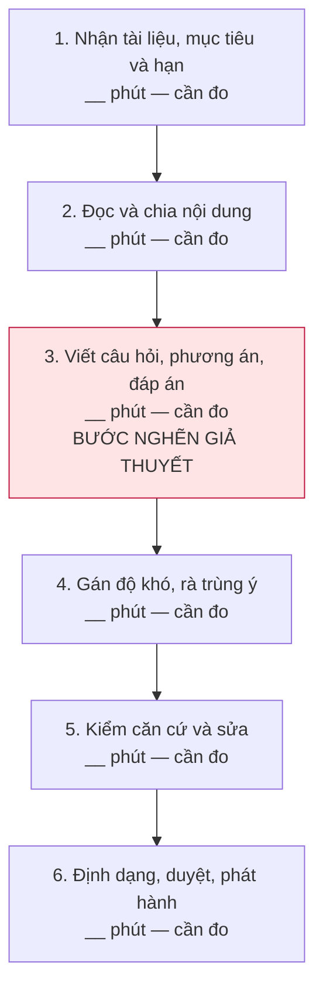
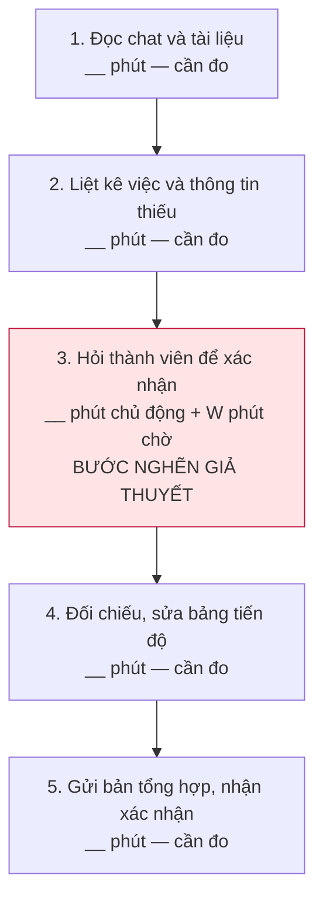
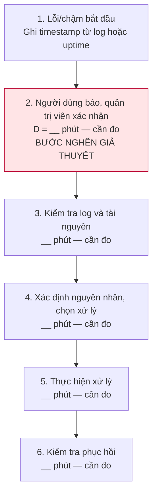

# Báo cáo cá nhân — Lê Thanh Tùng — 2A202603819

> **Bản cá nhân cập nhật từng phần — ngày 09/11/2026.** Đã chuẩn bị bảng scan, 3 Problem Card, 3 quy trình nháp và nguồn tham khảo. Học viên xác nhận **nhóm chưa họp**; CP3–CP6 và reflection CP7 sẽ bổ sung sau hoạt động nhóm. Đây chưa phải bài nộp hoàn tất.
>
> Năm vấn đề do học viên cung cấp; trợ lý hỗ trợ biên tập, phản biện và tìm nguồn. Số liệu công khai trong [memo nguồn](../assets/cp1-2-evidence-research.md) là tham khảo bên ngoài, không phải số đo hoặc phỏng vấn của học viên. Các ô **[CẦN ĐO]** và **[HỌC VIÊN TỰ ĐIỀN]** thể hiện thông tin chưa có; các target ghi là **đề xuất** chưa phải kết quả đạt được.

| Phần | Đã chuẩn bị | Còn bổ sung |
|---|---|---|
| CP1 | 5 vấn đề dạng Job Story, đủ 4 lăng kính, có nguồn tham khảo | Dấu hiệu và số đo trong bối cảnh thực tế của học viên |
| CP2 | 3 card, 3 sơ đồ, phương án không dùng AI và phản biện của trợ lý | Xác nhận thứ tự ưu tiên, quy trình và số phút từng bước |
| Nhật ký dùng AI | Ghi quá trình cung cấp ý tưởng, biên tập và tìm nguồn | Những lần sử dụng tiếp theo và nhận định riêng của học viên |
| CP3–CP6 | Chưa thực hiện: nhóm chưa họp | Pitch, phản biện giữa thành viên, lựa chọn và kết quả làm nhóm |
| CP7 | Giữ các câu hỏi theo mẫu | Reflection do học viên tự viết và giải thích bài nhóm |

## 1. Thông tin học viên

- Họ tên: Lê Thanh Tùng.
- MSSV: 2A202603819.
- Tên nhóm: Văn Minh — theo tên repo, cần đối chiếu thông tin nhóm.
- Link repo nhóm: https://github.com/TuHoAnh/K5-L3B-DAY02-VanMinh-DiscoveryProblemFraming.
- Phạm vi cập nhật lần này: CP1, CP2 và nhật ký sử dụng trợ lý trong quá trình chuẩn bị. Hoạt động nhóm và reflection được bổ sung sau khi thực hiện.

## 2. Scan problem (CP1)

Lăng kính: **Lặp lại** · **Tốn thời gian** · **Cần đọc, tổng hợp nhiều thông tin** · **Pain từ người khác**.

| # | Lăng kính | Job Story: Khi… tôi muốn… để… | Ai chịu ảnh hưởng? | Dấu hiệu và nguồn công khai đã tìm |
|---:|---|---|---|---|
| 1 | Pain từ người khác | **Nghi vấn gian lận thời gian học.** Khi quản lý một cộng đồng có bảng xếp hạng giờ học và nhận báo cáo về phiên học bị treo máy, tôi muốn xác minh phiên bị phản ánh theo tiêu chí nhất quán, để bảo vệ sự công bằng và tránh kết luận nhầm về thành viên. | Chính: quản trị viên cộng đồng. Liên quan: thành viên học tập và người bị báo cáo. | [Study Together FAQ, điều 18](https://www.studytogether.com/faq) có quy định chống farming; tính năng check-in mục tiêu nhắc sau **2 giờ**, chuyển AFK nếu không trả lời trong **10 phút**, nhưng không áp dụng phòng camera/màn hình. Đây là cơ chế, **chưa có tỷ lệ gian lận hoặc giờ xử lý report**. Cần kiểm thêm report/tuần, phút xử lý/report và số quyết định bị sửa sau khiếu nại. |
| 2 | Tốn thời gian; Cần đọc, tổng hợp nhiều thông tin | **Soạn đề từ tài liệu mới.** Khi nhận một tài liệu nghiệp vụ hoặc bài giảng mới, tôi muốn hoàn thành bộ 50 câu hỏi có đáp án, căn cứ và mức độ khó phù hợp, để đánh giá đúng nội dung người học cần nắm và phát hành bài kiểm tra kịp thời. | Giảng viên hoặc chuyên viên đào tạo phụ trách biên soạn đề. | [Nghiên cứu PAFMJ, công bố 2026](https://www.pafmj.org/PAFMJ/article/view/12930): hai giảng viên tạo **50 câu trong 205 phút**, bộ ChatGPT mất **25 phút**; **100 sinh viên y** làm hai bộ. Thời gian này thuộc khâu tạo câu hỏi trong nghiên cứu y khoa, **không phải toàn quy trình bộ đề được duyệt** hoặc baseline của học viên. |
| 3 | Tốn thời gian; Cần đọc, tổng hợp nhiều thông tin | **Kẹt khi xử lý lỗi lập trình.** Khi tự làm dự án vào ban đêm và gặp một lỗi logic có thể tái hiện nhưng chưa hiểu nguyên nhân, tôi muốn khoanh vùng được nguyên nhân trong ngữ cảnh mã hiện tại, để tiếp tục tính năng và kiểm tra được rằng lỗi đã được sửa. | Lập trình viên độc lập, sinh viên CNTT đang tự học hoặc làm dự án. | [Stack Overflow Survey 2022](https://survey.stackoverflow.co/2022/#professional-developers-productivity-impacts): **36.198** người trả lời mục này; khoảng **62%** dành trên **30 phút/ngày** tìm câu trả lời/lời giải. Tính cả tự tìm, hỏi và chờ đồng nghiệp; **không riêng debug, sinh viên hoặc ban đêm**. Chưa có tỷ lệ bỏ dở tính năng do lỗi từ nguồn này. |
| 4 | Pain từ người khác; Tốn thời gian | **Phát hiện muộn sự cố VPS.** Khi dịch vụ chạy trên VPS bị chậm hoặc gián đoạn vào giờ cao điểm, tôi muốn biết dấu hiệu bất thường và phạm vi ảnh hưởng sớm, để xử lý trước khi phải chờ người dùng nhắn báo. | Chính: người vận hành dự án/cộng đồng nhỏ. Liên quan: người dùng web hoặc bot. | [Cloudflare postmortem 02/07/2019](https://blog.cloudflare.com/details-of-the-cloudflare-outage-on-july-2-2019/): sự cố cạn CPU gây gián đoạn **27 phút**, cảnh báo tự động đầu tiên sau **3 phút** kể từ triển khai. Đây là case hệ thống lớn, **không phải số trung bình VPS nhỏ**; cũng phản bác nhận định mọi hệ thống đều phải đợi người dùng báo. Chưa có downtime/latency của dự án học viên. |
| 5 | Lặp lại; Cần đọc, tổng hợp nhiều thông tin | **Trôi thông tin và lệch tiến độ nhóm.** Khi tổng hợp tiến độ một dự án mà giao việc và thay đổi diễn ra qua nhóm chat, tôi muốn xác định đúng người phụ trách, hạn chót và trạng thái đã được xác nhận của từng việc, để tránh bỏ sót, làm trùng và cập nhật sai tiến độ. | Chính: trưởng nhóm. Liên quan: thành viên dự án sinh viên hoặc nhóm khởi nghiệp nhỏ. | [Asana Anatomy of Work 2022](https://investors.asana.com/node/6631/pdf): GWI khảo sát **10.624 lao động tri thức tại 7 quốc gia**; **58%** ngày làm việc dành cho điều phối. Phạm vi rộng hơn hỏi tiến độ qua chat; **không thể coi toàn bộ là lãng phí hoặc gán cho nhóm sinh viên**. Phút cập nhật/tuần và tỷ lệ task trễ của nhóm cụ thể chưa đo. |

**Nguồn ý tưởng và cách dùng trợ lý:** học viên cung cấp đủ 5 mô tả trước khi yêu cầu biên tập. Giữ cả 5; trợ lý chuyển thành Job Story, tách bước nghẽn và đề xuất phép đo. Học viên cần đọc lại để sửa những chỗ chưa khớp quy trình thật. Chưa có phỏng vấn hoặc survey nào được ghi nhận trong bản này.

**Các điểm đã được trợ lý yêu cầu làm rõ:**

- Vấn đề 1: camera bật hoặc ít chuyển động không đủ chứng minh có hay không học; cần tiêu chí xác minh và quyền giải trình. Số report phản ánh cả hành vi báo cáo, không trực tiếp là số vụ gian lận.
- Vấn đề 2: thay khẳng định chung “100% bằng sức người” bằng mô tả quy trình đang được học viên nêu; cần kiểm tra người soạn đã có ngân hàng câu hỏi hoặc công cụ nào chưa.
- Vấn đề 3: “lỗi lạ” và “kẹt tư duy” còn rộng; tập trung một lỗi logic tái hiện được, tính cả thời gian kiểm chứng bản sửa. Ban đêm là bối cảnh cần kiểm tra, chưa được khẳng định là nguyên nhân.
- Vấn đề 4: tách phát hiện muộn, chẩn đoán và khôi phục; CPU/RAM cao là tín hiệu, chưa mặc định là nguyên nhân duy nhất hoặc là điều có thể dự báo trước.
- Vấn đề 5: tách thời gian làm việc chủ động của trưởng nhóm khỏi thời gian chờ thành viên trả lời; kiểm tra xem cập nhật có bị thiếu vì quy ước làm việc hay vì thông tin khó tổng hợp.

## 3. Top 3 Problem Cards + quy trình nháp (CP2)

### Bảng chọn top 3 — đề xuất của trợ lý, chờ học viên xác nhận

| Rank | Problem | Vì sao đưa vào bản nháp | Điều còn chưa chắc |
|---:|---|---|---|
| 1 | #2 — Soạn bộ 50 câu hỏi từ tài liệu mới | Đầu vào và đầu ra xác định được; có thể đo cả thời gian lẫn chất lượng; so sánh được ngân hàng câu hỏi, template và hỗ trợ soạn nháp. | Khâu tốn nhất là đọc tài liệu, viết câu hỏi hay duyệt đáp án? Học viên có tiếp cận được người đang soạn đề thật không? |
| 2 | #5 — Tổng hợp tiến độ từ nhóm chat | Có actor và các điểm chuyển giao rõ; có thể đối chiếu tin nhắn với danh sách công việc; phương án đổi quy ước cập nhật có thể đủ. | Nguồn gốc trễ hạn có thật là trôi thông tin hay do quá tải/phụ thuộc công việc? Thành viên có cập nhật trạng thái không? |
| 3 | #4 — Phát hiện muộn sự cố VPS | Có timeline và chỉ số hệ thống để kiểm; giúp so sánh công bằng phương án Rule với các mức phức tạp hơn. | Có giữ log và kiểm tra uptime không? Chưa xác nhận nguyên nhân CPU/RAM hoặc khả năng cảnh báo sớm. |

#1 và #3 vẫn nằm trong bảng scan. Chưa đưa vào top 3 vì #1 cần làm rõ cách xác minh công bằng, còn #3 cần chọn một loại lỗi và timeline cụ thể trước khi vẽ quy trình đáng tin cậy. Thứ tự này có thể đổi theo bằng chứng, chưa phải lựa chọn của nhóm.

### Problem Card #1 — Soạn bộ đề kiểm tra từ tài liệu mới

| Trường | Nội dung |
|---|---|
| Job Story | Khi nhận tài liệu nghiệp vụ hoặc bài giảng mới, tôi muốn hoàn thành 50 câu hỏi có đáp án, căn cứ và mức độ khó phù hợp, để kiểm tra đúng nội dung cần học và phát hành kịp thời. |
| Actor | Người phụ trách soạn đề; người có chuyên môn rà nội dung và đáp án. Cần xác nhận đây là một người hay hai vai trò khác nhau. |
| Thời điểm / bối cảnh | Tài liệu mới được chốt; cần một bộ 50 câu hỏi trắc nghiệm trước một mốc đào tạo. Tài liệu nguồn và mục tiêu học tập phải được xác nhận trước khi soạn. |
| Quy trình hiện tại (3–7 bước) | 1. Nhận tài liệu, mục tiêu và hạn → 2. Đọc, chia nội dung cần đánh giá → 3. Viết câu hỏi, phương án và đáp án → 4. Gán mức khó, rà trùng ý → 5. Kiểm căn cứ và sửa câu chưa đạt → 6. Định dạng, duyệt và phát hành. Các bước là bản diễn giải từ mô tả học viên, cần đối chiếu người thực hiện. |
| Bottleneck (bước nào, mất bao nhiêu phút) | Giả thuyết: bước 3, chuyển nội dung thành câu hỏi phân biệt được mức độ hiểu, có phương án nhiễu hợp lý. Thời gian bước 3: **[CẦN ĐO: __ phút/50 câu được duyệt]**. Nếu bước 5 mới tốn nhất, phải đổi bottleneck. |
| Impact (nếu không giải thì sao) | Phát hành đề muộn hoặc tăng công rà sửa; câu hỏi có thể lặp ý, thiếu phủ nội dung hoặc sai đáp án. Chưa định lượng tổn thất của học viên/đơn vị cụ thể. |
| Success metric (baseline → target) | Gọi T50 là tổng phút lao động để có 50 câu **được duyệt**, gồm soạn và sửa: baseline **[CẦN ĐO]** → target **đề xuất ≤70% T50** trên tài liệu tương đương. Đo theo từng bước và cùng tiêu chí duyệt; ghi riêng thời gian chờ. Chất lượng: **đề xuất 0 câu sai đáp án hoặc không có căn cứ** sau duyệt, độ phủ theo ma trận mục tiêu đã được người phụ trách chốt. Chưa có kết quả thử nghiệm. |
| Phương án không dùng AI | Ma trận nội dung × mục tiêu × độ khó, mẫu câu hỏi, checklist rà đáp án và ngân hàng câu hỏi đã duyệt. Kiểm tra phương án này trước để biết còn phần việc nào thực sự cần hỗ trợ. |
| Giả thuyết về AI (nếu có) | Có thể hỗ trợ tạo nháp từ tài liệu được cung cấp và chỉ rõ đoạn căn cứ. Người có chuyên môn kiểm câu hỏi, đáp án, độ khó và duyệt trước phát hành. Chưa kiểm chứng rằng cách này giảm tổng thời gian sau khi tính công sửa. |
| Cảm nhận nhanh | **Chưa biết**; có thể No AI hoặc Workflow nếu khâu soạn nháp vẫn nghẽn sau khi đã dùng template/ngân hàng câu hỏi. Không có cơ sở chọn Agent. |

**Quy trình nháp hiện tại:** số phút từng bước chưa được đo; các ô trống không phải số liệu tham khảo từ nghiên cứu.

Tổng phút lao động: **T50 = t1 + t2 + t3 + t4 + t5 + t6**, cộng cả các vòng sửa lại. Thời gian từ lúc nhận tài liệu đến lúc phát hành được ghi riêng để không nhầm với công lao động.

### Problem Card #2 — Tổng hợp tiến độ nhóm từ thông tin trong chat

| Trường | Nội dung |
|---|---|
| Job Story | Khi cần cập nhật tiến độ mà giao việc và thay đổi diễn ra trong nhóm chat, tôi muốn xác định đúng người phụ trách, hạn chót và trạng thái được xác nhận của từng việc, để tránh bỏ sót, làm trùng và báo cáo sai tiến độ. |
| Actor | Trưởng nhóm tổng hợp; thành viên xác nhận trạng thái và thông tin công việc của mình. |
| Thời điểm / bối cảnh | Một lần chốt tiến độ định kỳ của một nhóm dự án dùng chat để giao và đổi việc. Tần suất, quy mô nhóm và công cụ thực tế: **[HỌC VIÊN TỰ ĐIỀN]**. |
| Quy trình hiện tại (3–7 bước) | 1. Đọc lại tin nhắn/tài liệu → 2. Lập danh sách việc và phát hiện thông tin thiếu → 3. Hỏi thành viên để xác nhận → 4. Đối chiếu các cập nhật mâu thuẫn, sửa bảng → 5. Gửi bản tổng hợp và nhận xác nhận. Cần kiểm xem nhóm thực tế có làm đủ các bước này không. |
| Bottleneck (bước nào, mất bao nhiêu phút) | Giả thuyết: bước 3, xác nhận lại owner/deadline/trạng thái do thông tin thiếu hoặc thay đổi trong chat. Công nhắn và đối chiếu: **[CẦN ĐO: __ phút/lần chốt]**; thời gian chờ phản hồi W ghi riêng. Nếu phần lớn công nằm ở bước 1 hoặc 4, đổi bottleneck theo số đo. |
| Impact (nếu không giải thì sao) | Tăng công điều phối; thành viên có thể bỏ sót hoặc làm trùng việc, trưởng nhóm cập nhật sai tiến độ. Tác động đến trễ hạn cần kiểm bằng từng task, tránh quy tất cả task trễ cho nhóm chat. |
| Success metric (baseline → target) | Tổng phút chủ động gom/xác nhận/cập nhật mỗi tuần T: baseline **[CẦN ĐO]** → target **đề xuất ≤70% T** qua một giai đoạn thử 2 tuần; ghi riêng W. Chất lượng: **đề xuất 100% task đến hạn có owner và deadline được xác nhận**, số trạng thái ghi sai sau khi thành viên kiểm không tăng. Ghi thêm lượt hỏi lại/task. |
| Phương án không dùng AI | Một bảng công việc chung; quy ước mỗi task có owner, deadline và một nơi cập nhật; mẫu báo cáo ngắn và giờ chốt. Thử việc này trước vì thông tin chưa được thành viên cung cấp thì công cụ tổng hợp cũng không thể biết. |
| Giả thuyết về AI (nếu có) | Nếu dữ liệu đầu vào đã có nhưng việc đọc và đối chiếu vẫn tốn thời gian, có thể tạo bản nháp cập nhật kèm đường dẫn tin nhắn gốc. Thành viên xác nhận; không suy diễn “xong việc” từ một câu chat mơ hồ hoặc tự đổi deadline. |
| Cảm nhận nhanh | **No AI trước**; cân nhắc Workflow nếu bằng chứng cho thấy còn tốn công đọc/tổng hợp sau khi thống nhất quy ước. |

**Quy trình nháp hiện tại:**

Tổng công chủ động mỗi lần chốt: **t1 + t2 + t3 + t4 + t5**. W là thời gian chờ thành viên, không cộng W như thể trưởng nhóm làm việc liên tục trong khoảng đó. Khi quy đổi theo tuần cần dùng tần suất chốt thực tế.

### Problem Card #3 — Phát hiện muộn sự cố trên VPS

| Trường | Nội dung |
|---|---|
| Job Story | Khi dịch vụ trên VPS chậm hoặc gián đoạn vào giờ cao điểm, tôi muốn nhận biết dấu hiệu và phạm vi ảnh hưởng sớm, để bắt đầu xử lý trước khi phải chờ người dùng nhắn báo. |
| Actor | Người vận hành dịch vụ/dự án nhỏ; người dùng là bên chịu chậm hoặc không truy cập được. |
| Thời điểm / bối cảnh | Một dịch vụ đang chạy trên VPS giới hạn tài nguyên. Cấu hình, loại dịch vụ và thời điểm cao điểm: **[HỌC VIÊN TỰ ĐIỀN]**. Chưa kết luận tài nguyên thiếu là nguyên nhân. |
| Quy trình hiện tại (3–7 bước) | 1. Dịch vụ phát sinh lỗi/chậm → 2. Người dùng phản ánh, người vận hành nhận biết → 3. Kiểm tra log và tài nguyên → 4. Xác định nguyên nhân, chọn cách xử lý → 5. Thực hiện xử lý → 6. Kiểm tra phục hồi. “Khởi động lại” chỉ là một cách xử lý trong mô tả ban đầu, không phải bước luôn đúng. |
| Bottleneck (bước nào, mất bao nhiêu phút) | Giả thuyết: khoảng từ bước 1 đến lúc người vận hành xác nhận ở bước 2. **D = thời điểm xác nhận sự cố − thời điểm đầu tiên log/kiểm tra uptime ghi nhận ảnh hưởng**, baseline **[CẦN ĐO: __ phút/sự cố]**. Nếu không có log trước lúc người dùng báo, D chưa tính được đáng tin cậy. |
| Impact (nếu không giải thì sao) | Chậm bắt đầu xử lý và kéo dài ảnh hưởng tới người dùng. Downtime là kết quả của cả phát hiện và khôi phục, nên không được coi toàn bộ downtime là thời gian chờ phát hiện. |
| Success metric (baseline → target) | D: baseline **[CẦN ĐO]** → target **đề xuất ≤5 phút** trong giai đoạn thử có log/kiểm tra uptime và người nhận cảnh báo. Theo dõi thêm tổng phút gián đoạn/30 ngày, latency p95 ở cùng khung giờ và số cảnh báo không cần hành động/ngày. Mục tiêu kiểm soát nhiễu **đề xuất ≤1 cảnh báo không cần hành động/ngày**; chưa có số đo thực tế. |
| Phương án không dùng AI | Kiểm tra uptime từ bên ngoài, thu thập CPU/RAM/disk và lỗi ứng dụng; đặt ngưỡng cùng điều kiện kéo dài, gửi cảnh báo tới người phụ trách; có checklist kiểm tra sự cố. Xác nhận hệ thống đã có những thứ gì trước khi đề xuất thêm. |
| Giả thuyết về AI (nếu có) | Chỉ cân nhắc hỗ trợ đọc/tóm tắt log khi bước chẩn đoán được chứng minh là nghẽn. Cảnh báo tài nguyên và uptime chưa cần mô hình ngôn ngữ. Chưa có dữ liệu để đề xuất dự báo tải, tự nâng cấu hình hoặc tự khởi động lại. |
| Cảm nhận nhanh | **Rule** là mức đáng kiểm tra trước. Không có lý do chọn Agent ở thời điểm này. |

Đối chiếu phương án có sẵn: [DigitalOcean Monitoring Quickstart](https://docs.digitalocean.com/products/monitoring/getting-started/quickstart/) mô tả cảnh báo theo ngưỡng với khoảng duy trì **5, 10, 30 phút hoặc 1 giờ**. Đây là thông số cấu hình, không phải cam kết thời gian người vận hành nhận biết. Khi thử target D ≤5 phút cần chọn cửa sổ kiểm tra phù hợp và tính cả độ trễ gửi/nhận cảnh báo.

**Quy trình nháp hiện tại:**

Thời gian khôi phục quan sát từ sự cố tới khi dịch vụ hoạt động lại gồm D và các bước 3–6. Phải ghi riêng thời gian dịch vụ thực sự không phục vụ được; không mặc định toàn bộ chuỗi kiểm tra đều là downtime.

### Card muốn pitch nhất

- Đề xuất để học viên cân nhắc: Card #1 — soạn đề kiểm tra, vì đầu ra có thể kiểm cụ thể theo số câu được duyệt, độ phủ và thời gian.
- Card học viên thực sự chọn: **[HỌC VIÊN TỰ ĐIỀN]**.
- Câu hỏi học viên muốn nhóm phản biện: **[HỌC VIÊN TỰ ĐIỀN sau khi đọc và kiểm lại card]**.

### AI đã phản biện card thế nào

Đây là phản biện của trợ lý trong quá trình soạn nháp. Cột xác nhận để học viên tự quyết định; không ghi nhận rằng học viên hoặc nhóm đã đồng ý khi chưa có phản hồi.

| Điểm yếu AI chỉ ra | Học viên đồng ý? | Điều chỉnh trong bản nháp để học viên xem lại |
|---|---|---|
| Card #1 chỉ đo tốc độ sẽ khuyến khích làm nhiều câu nông hoặc sai; review có thể xóa hết lợi ích thời gian. | [HỌC VIÊN TỰ ĐIỀN] | Đo tổng công để có 50 câu được duyệt, gồm sửa; thêm căn cứ, đáp án và độ phủ. |
| Card #2 có thể là vấn đề quy ước cập nhật, không phải thiếu công cụ tổng hợp. | [HỌC VIÊN TỰ ĐIỀN] | Thêm phương án bảng task chung và quy ước cập nhật trước; tách thời gian chờ khỏi công chủ động. |
| Card #3 đang gộp phát hiện, chẩn đoán và khôi phục; cảnh báo ngưỡng có thể đủ. | [HỌC VIÊN TỰ ĐIỀN] | Đặt D làm metric phát hiện; tách downtime, thêm Rule và chỉ cân nhắc hỗ trợ đọc log nếu còn nghẽn. |
| Cả 3 card chưa có số đo tại bối cảnh học viên; thống kê bên ngoài không thể trở thành baseline của học viên. | [HỌC VIÊN TỰ ĐIỀN] | Giữ rõ nguồn bên ngoài, target đề xuất và các ô cần đo; chưa kết luận đã kiểm chứng. |

## 4. Tôi đã tham gia phần nào (CP3 → CP7)

**Trạng thái ngày 09/11/2026:** học viên xác nhận nhóm chưa họp. Bảng ghi rõ phần đã chuẩn bị cá nhân và phần chưa diễn ra; phản biện của trợ lý ở mục 3 không được tính là phản biện giữa các thành viên tại CP3.

| Hoạt động | Việc đã làm / trạng thái | Kết quả / thông tin sẽ cập nhật |
|---|---|---|
| Chuẩn bị cá nhân trước CP3 | Cung cấp 5 mô tả vấn đề; yêu cầu trợ lý kiểm đề, biên tập và tìm số liệu công khai. | Bảng scan, 3 card và nguồn tham khảo ở mục 2–3; chưa phải kết quả hội tụ của nhóm. |
| Pitch Problem Card | Chưa thực hiện. | Sau CP3: ghi card thực sự trình bày và phản hồi nhận được. |
| Phản biện bài của bạn khác | Chưa thực hiện. | Sau CP3: ghi câu hỏi đã đặt, người nhận theo vai trò và ảnh hưởng cụ thể. |
| Nhận phản biện từ thành viên | Chưa thực hiện. | Sau CP3: ghi câu hỏi thực tế và điều đã sửa. |
| Gom cluster / cây OST | Chưa thực hiện. | Bổ sung phần trực tiếp tham gia và liên kết báo cáo nhóm. |
| Chọn candidate problem | Nhóm chưa chọn. | Bổ sung candidate, lý do và phần đóng góp cá nhân vào quyết định. |
| Kiểm chứng / research | Đã có memo nguồn do trợ lý hỗ trợ; chưa ghi nhận phỏng vấn/survey hoặc học viên tự mở kiểm nguồn. | Bổ sung hoạt động kiểm chứng thực tế và nguồn học viên đã tự kiểm. |
| Quy trình nhóm | Chưa thực hiện; các sơ đồ ở mục 3 là quy trình nháp cho từng card. | Sau CP5: liên kết phần quy trình của nhóm và ghi đóng góp. |
| Problem Statement | Chưa có bản của nhóm. | Sau CP5–CP6: ghi phần tham gia và thay đổi từ v0 sang v1. |
| Mức can thiệp AI | Chưa có lựa chọn của nhóm. | Sau CP6: ghi lập luận cá nhân và mức được nhóm chốt. |
| Quyết định | Chưa có quyết định của nhóm. | Sau CP6: ghi Go / Not Yet / No-Go và căn cứ. |

## 5. Dùng AI

Bảng này ghi những gì đã diễn ra trong trao đổi chuẩn bị bản nháp; không thay cho nhật ký hoạt động nhóm.

| Checkpoint | Tôi dùng AI để làm gì? | AI hữu ích ở đâu? | Sai/hời hợt hoặc giới hạn ở đâu? | Tôi sửa gì bằng nhận định của mình? |
|---|---|---|---|---|
| CP1 Scan | Cung cấp 5 mô tả và nhờ trợ lý kiểm yêu cầu, sắp xếp theo template. | Xác nhận ít nhất 5 vấn đề; chuyển mô tả sang Job Story và gợi ý phép đo. | Chưa có trải nghiệm trực tiếp hoặc log của học viên; bản diễn giải có thể không khớp quy trình thật. | Học viên đã chọn danh sách 5 vấn đề thay cho các gợi ý trước. Phần sửa thêm sau khi xem bản nháp: [HỌC VIÊN TỰ ĐIỀN]. |
| CP2 Problem Card | Nhờ trợ lý tạm chọn 3 card, vẽ quy trình và phản biện. | Tách tốc độ/chất lượng đề thi; tách chờ/phút chủ động; tách phát hiện/khôi phục VPS. | Thứ tự top 3 và bước nghẽn mới là giả thuyết do trợ lý đề xuất, chưa được học viên xác nhận. | [HỌC VIÊN TỰ ĐIỀN sau khi quyết định giữ hoặc sửa card]. |
| Research chuẩn bị | Yêu cầu trợ lý tự tìm số liệu công khai cho 5 vấn đề. | Đã có 8 nguồn sơ cấp trong memo; số liệu tham khảo được dẫn trực tiếp ở bảng scan. | Chưa tìm được tỷ lệ gian lận giờ học hoặc baseline VPS nhỏ đáng tin cậy; nguồn bên ngoài không phải số đo của học viên. | [HỌC VIÊN TỰ ĐIỀN sau khi mở nguồn và chọn số nào thực sự dùng]. |
| CP4 Phỏng vấn | Chưa thực hiện; nhóm chưa họp. | — | Chưa có dữ liệu phỏng vấn hoặc survey. | Bổ sung sau khi hỏi người thật. |
| CP5–6 | Chưa thực hiện; nhóm chưa họp. | — | Chưa có Problem Statement hoặc quyết định của nhóm. | Bổ sung sau hoạt động nhóm. |

## 6. Reflection (CP7)

**Chưa thực hiện vì nhóm chưa họp.** Học viên tự viết bằng trải nghiệm thật sau khi làm việc nhóm: tối thiểu 200 từ cho các câu 6.1–6.6, không tính câu 6.7. Các câu dưới đây giữ theo template để bổ sung; chưa có phần reflection hoàn tất.

**6.1. Tôi học được gì khi nghe top 3 problems của các bạn khác?**

[HỌC VIÊN TỰ ĐIỀN]

**6.2. Nhóm có lúc nào bị “solution-first” (nghĩ giải pháp trước khi hiểu vấn đề) không? Lúc đó nhóm nhận ra và xử lý thế nào?**

[HỌC VIÊN TỰ ĐIỀN]

**6.3. Tôi có đổi ý sau khi bị phản biện không? Kể một lần cụ thể.**

[HỌC VIÊN TỰ ĐIỀN]

**6.4. Kết quả kiểm chứng (phỏng vấn/survey/research) có làm tôi bất ngờ không? Điều gì?**

[HỌC VIÊN TỰ ĐIỀN]

**6.5. Điều khó nhất khi viết Problem Statement là gì?**

[HỌC VIÊN TỰ ĐIỀN]

**6.6. Nếu làm lại, tôi sẽ đổi gì? Tôi sẽ phản biện nhóm mạnh hơn ở điểm nào?**

[HỌC VIÊN TỰ ĐIỀN]

**6.7. Hiểu bài:** giải thích bằng 5–8 câu, không nhìn tài liệu, chuỗi *problem → quy trình → metric → boundary → mức can thiệp AI → quyết định* của bài nhóm mình.

[HỌC VIÊN TỰ ĐIỀN sau khi nhóm có quyết định]

## 7. Tài liệu tham khảo

- Năm mô tả vấn đề do học viên cung cấp trong cuộc trao đổi ngày 09/11/2026.
- [README — lịch CP1 5+ problems, CP2 top 3](../../README.md).
- [CHECKPOINTS — sản phẩm và tiêu chí tự kiểm CP1, CP2, CP7](../../CHECKPOINTS.md).
- [Worksheet — Job Story, Problem Card và quy trình nháp](../../docs/01-worksheet.md).
- [Rubric — điểm cá nhân và yêu cầu dấu hiệu thật](../../RUBRIC.md).
- [Rules — cách dùng trợ lý, bằng chứng và reflection](../../RULES.md).
- [Memo kiểm tra số liệu công khai cho 5 vấn đề](../assets/cp1-2-evidence-research.md).
