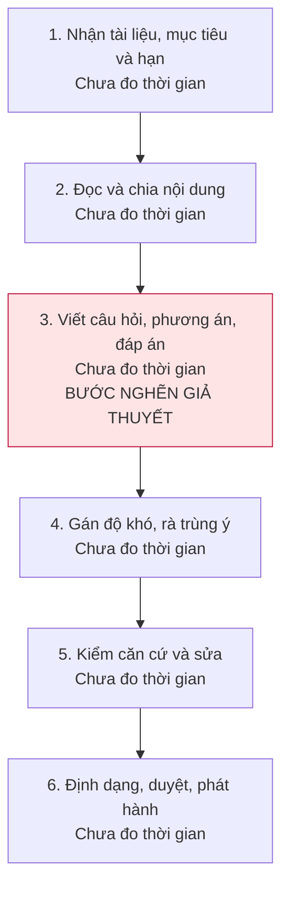
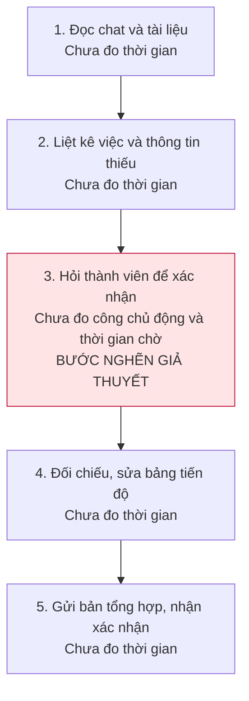
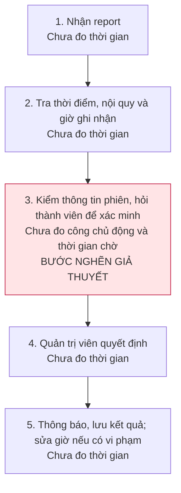

# Báo cáo cá nhân — Lê Thanh Tùng — 2A202603819

> Báo cáo cá nhân ngày 09/11/2026, gồm scan vấn đề, ba Problem Card, đóng góp cho hướng LabCheck và nhật ký dùng AI. Phần CP6 đã có đề xuất trong báo cáo chung. Chưa có số đo trực tiếp hoặc phỏng vấn trong phần tôi phụ trách; reflection có AI hỗ trợ, được ghi rõ tại mục 6.

## 1. Thông tin học viên

- Họ tên: Lê Thanh Tùng.
- MSSV: 2A202603819.
- Tên nhóm: Văn Minh — theo tên repo.
- Link repo nhóm: https://github.com/TuHoAnh/K5-L3B-DAY02-VanMinh-DiscoveryProblemFraming.

## 2. Scan problem (CP1)

Tôi đưa ra 5 vấn đề liên quan đến học tập trực tuyến, đào tạo, lập trình và làm việc nhóm. Tôi muốn làm rõ ai gặp khó khăn, nghẽn ở bước nào và có thể đo bằng gì trước khi nghĩ đến cách giải quyết.

Các con số dưới đây lấy từ nguồn công khai để tham khảo. Tôi chưa có số đo trong từng bối cảnh cụ thể; thông số sản phẩm hoặc kết quả của một nghiên cứu không thay cho số liệu của cộng đồng hay dự án đang xét.

| # | Lăng kính | Job Story: Khi… tôi muốn… để… | Ai chịu ảnh hưởng? | Dấu hiệu và nguồn tham khảo |
|---:|---|---|---|---|
| 1 | Pain từ người khác | **Gian lận thời gian trong cộng đồng học tập.** Khi quản lý một cộng đồng có xếp hạng giờ học và nhận báo cáo treo máy, tôi muốn xác minh phiên bị phản ánh theo nội quy, để giữ công bằng cho người học thật và tránh xử lý nhầm. | Quản trị viên và thành viên cộng đồng. | [Study Together](https://www.studytogether.com/faq) có quy định chống farming. Tính năng check-in mục tiêu nhắc sau **2 giờ**, chuyển AFK nếu không trả lời trong **10 phút**, nhưng không áp dụng cho phòng camera/màn hình. Nguồn này cho thấy đã có quy định xử lý vấn đề, chưa cho biết tỷ lệ vi phạm hay số giờ quản trị viên phải kiểm tra. |
| 2 | Tốn thời gian; Cần đọc, tổng hợp nhiều thông tin | **Tốn thời gian tạo đề kiểm tra.** Khi có tài liệu nghiệp vụ hoặc bài giảng mới, tôi muốn soạn được bộ 50 câu hỏi có đáp án và độ khó phù hợp, để đánh giá đúng nội dung người học cần nắm và phát hành kịp thời. | Giảng viên, chuyên viên đào tạo nội bộ. | [Nghiên cứu PAFMJ, công bố 2026](https://www.pafmj.org/PAFMJ/article/view/12930) ghi nhận hai giảng viên tạo **50 câu trong 205 phút**, bộ ChatGPT mất **25 phút**; **100 sinh viên y** làm hai bộ. Đây là thời gian tạo câu hỏi trong một nghiên cứu y khoa, chưa tính quy trình duyệt bộ đề để phát hành. |
| 3 | Tốn thời gian; Cần đọc, tổng hợp nhiều thông tin | **Kẹt khi fix bug ban đêm.** Khi tự học hoặc làm dự án vào ban đêm và gặp lỗi logic chưa hiểu nguyên nhân, tôi muốn khoanh vùng lỗi trong ngữ cảnh code hiện tại, để tiếp tục tính năng và kiểm tra được bản sửa. | Lập trình viên độc lập, sinh viên CNTT. | [Stack Overflow Survey 2022](https://survey.stackoverflow.co/2022/#professional-developers-productivity-impacts): mục này có **36.198** phản hồi; khoảng **62%** dành trên **30 phút/ngày** tìm câu trả lời hoặc lời giải. Số này tính cả hỏi và chờ đồng nghiệp, không chỉ debug và không riêng ban đêm. |
| 4 | Pain từ người khác; Tốn thời gian | **VPS gặp sự cố nhưng phát hiện muộn.** Khi web hoặc bot chạy trên VPS bị chậm hay gián đoạn, tôi muốn nhận biết dấu hiệu bất thường sớm, để bắt đầu xử lý trước khi phải chờ người dùng nhắn báo. | Người vận hành dự án và người dùng dịch vụ. | [Cloudflare, sự cố ngày 02/07/2019](https://blog.cloudflare.com/details-of-the-cloudflare-outage-on-july-2-2019/): cạn CPU gây gián đoạn **27 phút**, cảnh báo tự động đầu tiên sau **3 phút** từ lúc triển khai. Đây là hệ thống lớn, không phải baseline cho VPS nhỏ; case này cũng cho thấy có thể phát hiện bằng giám sát tự động. |
| 5 | Lặp lại; Cần đọc, tổng hợp nhiều thông tin | **Trôi thông tin và lệch tiến độ nhóm.** Khi việc giao task và cập nhật tiến độ nằm trong nhóm chat, tôi muốn biết rõ ai làm gì, hạn nào và đang đến đâu, để tránh bỏ sót, làm trùng hoặc hiểu sai công việc. | Trưởng nhóm và các thành viên dự án. | [Asana Anatomy of Work 2022](https://investors.asana.com/node/6631/pdf): GWI khảo sát **10.624 lao động tri thức tại 7 quốc gia**; **58%** ngày làm việc dành cho điều phối. Phạm vi này rộng hơn hỏi tiến độ qua chat, không thể coi toàn bộ là lãng phí hay áp thẳng cho nhóm sinh viên. |

Một số điểm cần kiểm tra thêm:

- **Giờ học:** bật camera hoặc ít chuyển động chưa đủ để kết luận đang học hay gian lận. Cần biết cộng đồng quy định thế nào và quản trị viên xác minh report ra sao.
- **Tạo đề:** cần xác định khâu tốn nhất là đọc tài liệu, viết câu hỏi hay rà sửa; đồng thời kiểm tra người soạn đã dùng ngân hàng câu hỏi chưa.
- **Debug:** nên chọn một lỗi tái hiện được để theo dõi. Chưa có bằng chứng rằng ban đêm là nguyên nhân gây kẹt hoặc câu trả lời trên mạng luôn không phù hợp.
- **VPS:** cần tách thời gian phát hiện khỏi thời gian chẩn đoán và khôi phục. CPU/RAM cao chưa chắc là nguyên nhân duy nhất.
- **Tiến độ nhóm:** cần phân biệt thông tin khó tổng hợp với việc thành viên chưa cập nhật. Nếu đầu vào còn thiếu thì thêm công cụ chưa chắc giúp được.

## 3. Top 3 Problem Cards + quy trình nháp (CP2)

### Ba vấn đề chuẩn bị để trao đổi

Đây là danh sách tạm cho CP2, chưa phải lựa chọn chung của nhóm.

| Thứ tự | Vấn đề | Lý do đưa vào | Điều còn chưa rõ |
|---:|---|---|---|
| 1 | #2 — Soạn bộ đề từ tài liệu mới | Có đầu vào là tài liệu và đầu ra là bộ câu hỏi; có thể kiểm cả thời gian lẫn chất lượng. | Bước nào thực sự tốn nhất? Việc sửa và duyệt câu hỏi mất bao lâu? |
| 2 | #5 — Tổng hợp tiến độ qua chat | Có thể lần theo tin nhắn, task và các lần phải hỏi lại để tìm chỗ nghẽn. | Trễ việc do thông tin bị trôi hay do quá tải, phụ thuộc công việc khác? |
| 3 | #1 — Gian lận thời gian trong cộng đồng học tập | Tôi hiểu vấn đề này hơn so với VPS nên chọn để phân tích kỹ và chuẩn bị trao đổi. | Cộng đồng tính giờ thế nào? Dấu hiệu nào đủ để xác minh một report mà không xử lý nhầm? |

Tôi thay VPS bằng gian lận thời gian học trong top 3 vì hiểu vấn đề này hơn. VPS và debug vẫn được giữ trong bảng scan; với debug cần thu hẹp vào một loại lỗi và một lần xử lý cụ thể. Thứ tự card dưới đây dùng để đánh số, còn card tôi muốn trao đổi trước là #3.

### Problem Card #1 — Tạo đề kiểm tra từ tài liệu mới

| Trường | Nội dung |
|---|---|
| Job Story | Khi có tài liệu nghiệp vụ hoặc bài giảng mới, tôi muốn soạn được 50 câu hỏi có đáp án và độ khó phù hợp, để đánh giá đúng nội dung cần học và phát hành kịp thời. |
| Actor | Giảng viên hoặc chuyên viên đào tạo phụ trách soạn đề; người có chuyên môn duyệt nội dung. |
| Thời điểm / bối cảnh | Tài liệu và mục tiêu học tập đã có, cần hoàn thành một bộ đề trước buổi đào tạo. |
| Quy trình hiện tại (3–7 bước) | Nhận tài liệu → Đọc, chọn nội dung cần kiểm tra → Viết câu hỏi và đáp án → Rà độ khó, trùng ý → Kiểm căn cứ và sửa → Duyệt, phát hành. |
| Bottleneck (bước nào, mất bao nhiêu phút) | Dự kiến ở bước viết câu hỏi: phải chuyển ý chính thành câu hỏi có phương án nhiễu hợp lý. **Chưa đo số phút/bộ đề**; cần kiểm tra xem khâu rà sửa có tốn hơn không. |
| Impact (nếu không giải thì sao) | Đề phát hành muộn, mất thêm công sửa, hoặc có câu hỏi nông, lặp ý, sai đáp án. |
| Success metric (baseline → target) | Gọi T50 là tổng phút để có **50 câu được duyệt**, gồm cả sửa. Baseline chưa đo; mục tiêu đề xuất là **≤70% T50** trên tài liệu tương đương. Ghi thời gian từng bước và thời gian chờ riêng; kiểm cả đáp án, căn cứ và độ phủ, không chỉ đếm số câu tạo ra. Sau duyệt, mục tiêu là **0 câu sai đáp án hoặc không có căn cứ**. |
| Phương án không dùng AI | Dùng ma trận nội dung × mục tiêu × độ khó, mẫu câu hỏi, checklist và ngân hàng câu hỏi đã duyệt. |
| Giả thuyết về AI (nếu có) | Hỗ trợ tạo nháp từ tài liệu, kèm đoạn làm căn cứ. Người có chuyên môn vẫn kiểm và duyệt. Cần tính cả công sửa để biết có tiết kiệm thời gian thật không. |
| Cảm nhận nhanh | Chưa chốt. Thử template/ngân hàng câu hỏi trước; cân nhắc Workflow nếu khâu soạn nháp vẫn nghẽn. |

Quy trình nháp; số phút từng bước sẽ bổ sung sau khi đo:

Tổng thời gian chủ động T50 gồm 6 bước và các vòng sửa lại. Thời gian chờ duyệt ghi riêng. Mốc 205 phút trong nghiên cứu ở CP1 chỉ dùng tham khảo khâu tạo câu hỏi.

### Problem Card #2 — Trôi thông tin và lệch tiến độ nhóm

| Trường | Nội dung |
|---|---|
| Job Story | Khi giao task và cập nhật tiến độ qua chat, tôi muốn biết rõ ai phụ trách, hạn nào và trạng thái đã được xác nhận, để tránh bỏ sót, làm trùng và báo cáo sai tiến độ. |
| Actor | Trưởng nhóm tổng hợp; thành viên xác nhận công việc của mình. |
| Thời điểm / bối cảnh | Một lần chốt tiến độ của nhóm dự án dùng chat để giao việc và thay đổi yêu cầu. Quy mô, tần suất và công cụ cụ thể chưa được ghi nhận. |
| Quy trình hiện tại (3–7 bước) | Đọc lại chat/tài liệu → Lập danh sách việc và thông tin thiếu → Hỏi từng người → Đối chiếu, sửa bảng tiến độ → Gửi tổng hợp và nhận xác nhận. |
| Bottleneck (bước nào, mất bao nhiêu phút) | Dự kiến ở bước hỏi lại để xác nhận người phụ trách, deadline và trạng thái. **Chưa đo phút/lần chốt**; thời gian chờ trả lời W được ghi riêng. |
| Impact (nếu không giải thì sao) | Trưởng nhóm mất công nhắc và gom thông tin; thành viên có thể làm trùng hoặc bỏ sót việc. Cần kiểm từng task trễ để xác định phần thực sự do thiếu thông tin. |
| Success metric (baseline → target) | Tổng phút chủ động cập nhật mỗi tuần T: chưa đo → mục tiêu đề xuất **≤70% T** trong đợt thử 2 tuần. Theo dõi lượt hỏi lại/task; mục tiêu **100% task đến hạn có người phụ trách và deadline được xác nhận**, số trạng thái ghi sai sau kiểm tra không tăng. |
| Phương án không dùng AI | Một bảng task chung, quy định rõ nơi cập nhật, người phụ trách và hạn chót; chốt tiến độ theo mẫu ngắn. |
| Giả thuyết về AI (nếu có) | Nếu thông tin đã có nhưng đọc và tổng hợp vẫn lâu, có thể tạo nháp cập nhật kèm link tin nhắn gốc. Thành viên xác nhận trước khi dùng; không tự suy diễn đã xong việc hoặc tự đổi deadline. |
| Cảm nhận nhanh | No AI trước. Chỉ cân nhắc Workflow nếu đã thống nhất cách cập nhật mà vẫn mất nhiều công tổng hợp. |

Quy trình nháp:

Công chủ động mỗi lần chốt là tổng 5 bước. W là thời gian chờ phản hồi, không tính toàn bộ W thành giờ làm việc của trưởng nhóm. Muốn quy đổi theo tuần cần biết tần suất thực tế.

### Problem Card #3 — Gian lận thời gian trong cộng đồng học tập trực tuyến

| Trường | Nội dung |
|---|---|
| Job Story | Khi quản lý một cộng đồng có bảng xếp hạng giờ học và nhận report về việc treo máy, tôi muốn xác minh phiên bị phản ánh theo nội quy, để giữ công bằng cho người học thật và tránh xử lý nhầm. |
| Actor | Quản trị viên trực tiếp kiểm tra report; người học và thành viên bị báo cáo là các bên liên quan. |
| Thời điểm / bối cảnh | Cộng đồng ghi giờ học từ phiên tham gia phòng, có camera hoặc chia sẻ màn hình và dùng giờ để xếp hạng. Tôi hiểu vấn đề này hơn so với VPS; chưa có thống kê report và thời gian xử lý của một cộng đồng cụ thể trong bài. |
| Quy trình hiện tại (3–7 bước) | Nhận report → Tra thời điểm, nội quy và số giờ được ghi → Kiểm tra thông tin phiên, hỏi thành viên để xác minh → Quản trị viên quyết định → Thông báo và lưu kết quả, điều chỉnh giờ nếu xác nhận vi phạm. |
| Bottleneck (bước nào, mất bao nhiêu phút) | Bước xác minh: quản trị viên phải đối chiếu report, thông tin phiên và giải thích của thành viên. Không thể theo dõi liên tục mọi màn hình; một ảnh chụp hoặc việc ít chuyển động cũng chưa đủ để kết luận. **Chưa đo phút/report** và tổng giờ kiểm tra/tuần. |
| Impact (nếu không giải thì sao) | Giờ ghi nhận có thể không phản ánh việc học theo nội quy, gây tranh cãi về bảng xếp hạng và tăng công kiểm tra. Nếu xử lý nhầm thì người học hợp lệ cũng bị ảnh hưởng. |
| Success metric (baseline → target) | Gọi T là số phút chủ động xác minh trung bình/report đã xử lý: baseline chưa đo → mục tiêu đề xuất **≤70% T** trong đợt thử 2 tuần. Ghi thêm tổng giờ kiểm tra/tuần, số report và số report xác nhận vi phạm. Chất lượng: tỷ lệ quyết định phải sửa sau khi xem lại **không tăng**. Số report chỉ dùng theo dõi tình hình, không tự coi report giảm là gian lận giảm. |
| Phương án không dùng AI | Làm rõ nội quy tính giờ và nghỉ hợp lệ; mẫu report có thời điểm, mô tả và thông tin cần kiểm; checklist xác minh; check-in theo quy tắc nếu phù hợp với nội quy. Quản trị viên xử lý các trường hợp cần xem xét. |
| Giả thuyết về AI (nếu có) | Nếu đọc và gom nhiều report là phần tốn thời gian, có thể hỗ trợ tóm tắt thông tin được phép truy cập, kèm nguồn để quản trị viên đối chiếu. Không dùng việc nhìn camera để tự kết luận ai đang học; không tự trừ giờ hoặc khóa tài khoản. |
| Cảm nhận nhanh | No AI / Rule trước để chuẩn hóa cách tính giờ, check-in và xử lý report. Chỉ cân nhắc Workflow khi việc đọc, tổng hợp report thực sự còn nghẽn. |

Quy trình nháp; số phút từng bước sẽ bổ sung sau khi theo dõi một lần xử lý thực tế:

Thời gian chủ động xác minh T được ghi ở bước 3; thời gian chờ thành viên phản hồi W ghi riêng. Tổng công kiểm tra mỗi tuần cần tính cả các bước khác và các lượt kiểm tra chưa phát sinh report, tránh chỉ chuyển công từ bước này sang bước khác.

Nguồn tham khảo cho nội quy chống farming và cách ghi giờ nằm ở [memo, mục 1](../assets/cp1-2-evidence-research.md#1-cày-giờ-trong-cộng-đồng-học-trực-tuyến). Những nguồn này chưa cho biết tỷ lệ gian lận hoặc thời gian quản trị viên mất trong cộng đồng đang xét.

### Card dự kiến trao đổi trước

- Card #3 — gian lận thời gian học: tôi hiểu vấn đề này hơn và muốn trao đổi trước về cách xác minh report, công kiểm tra và sự công bằng của bảng xếp hạng.
- Thứ tự này đang để chuẩn bị, có thể thay đổi sau khi kiểm tra dữ liệu và trao đổi với nhóm.
- Câu hỏi chuẩn bị để xin phản biện, có AI hỗ trợ diễn đạt: “Thông tin nào đủ để quản trị viên xác minh một report treo máy mà không xử lý nhầm người đang học hoặc nghỉ hợp lệ?” Đây chưa phải câu hỏi đã trao đổi trực tiếp trong CP3.

### Phản biện bằng AI và điều chỉnh trong bản nháp

| Nhận xét | Điều chỉnh trong bản nháp | Việc cần kiểm tra tiếp |
|---|---|---|
| Tạo đề nhanh hơn chưa chắc có lợi nếu phải sửa nhiều. | Đo tổng công để có 50 câu được duyệt, thêm kiểm đáp án, căn cứ và độ phủ. | Ghi riêng thời gian soạn và sửa. |
| Tiến độ nhóm có thể vướng ở cách cập nhật, không phải ở công cụ. | Thêm phương án bảng task chung và quy ước cập nhật; tách công chủ động khỏi thời gian chờ. | Xem thông tin đã có nhưng khó tìm hay chưa được cung cấp. |
| Camera bật, ít chuyển động hoặc có report chưa đủ chứng minh gian lận. | Tập trung vào quy trình xác minh theo nội quy; để quản trị viên quyết định và theo dõi các quyết định phải sửa. | Làm rõ cách tính giờ, nghỉ hợp lệ và thông tin dùng để kiểm tra từng report. |
| Số liệu bên ngoài chưa phải baseline của các tình huống đang xét. | Giữ nguồn, ghi rõ giới hạn và để phần chưa đo thay vì gán số. | Bổ sung số đo trực tiếp trước khi chốt mục tiêu. |

## 4. Tôi đã tham gia phần nào (CP3 → CP7)

Sau phần cá nhân, tôi nhờ đối chiếu bài của Tú, Khánh và Bình với README để xem hướng nào phù hợp cho nhóm. Tôi chuyển sang chuẩn bị bài trình bày cho vấn đề sau:

> Khi chuẩn bị nộp một bài lab, học viên muốn xác định bài còn thiếu yêu cầu nào và có sai quy cách nộp hay không, để sửa kịp trước deadline và tránh mất điểm do bỏ sót.

Đây là hướng tôi dùng để chuẩn bị demo. Bảng dưới ghi công việc đã chuẩn bị, không thay cho biên bản pitch, phỏng vấn hoặc quyết định chung của nhóm.

| Hoạt động | Tôi đã làm gì? | Kết quả / ảnh hưởng tới bài nhóm |
|---|---|---|
| Chuẩn bị pitch Problem Card | Chuẩn bị 3 card ở mục 3; chọn gian lận giờ học để trao đổi trước vì tôi hiểu bối cảnh này hơn VPS. | Bảng pitch của báo cáo nhóm đã có 3 candidate của tôi ở dòng 7–9. Chưa có biên bản xác nhận nội dung tôi đã nói trong buổi pitch. |
| Phản biện bài của bạn khác | Nhờ AI đọc và đối chiếu bài của 3 bạn với yêu cầu đề bài. | Đây là bước đọc chuẩn bị. Tôi chưa có câu hỏi đã trực tiếp đặt cho bạn nào để ghi vào nhật ký phản biện CP3. |
| Nhận phản biện | Nhận phản biện bằng AI về việc camera ít chuyển động chưa chứng minh gian lận; số liệu tham khảo chưa phải baseline. | Đã sửa card #3 theo hướng xác minh report, để quản trị viên quyết định. Chưa có câu hỏi nhận trực tiếp từ thành viên nhóm. |
| Gom cluster / cây OST | Chuẩn bị ghi chú về điểm chung giữa rà rubric của Tú, chuẩn bị file của Khánh và xác định yêu cầu của Bình. | Có cơ sở đề xuất cluster “đối chiếu yêu cầu trước khi nộp”. Cây OST chính thức vẫn thuộc phần nhóm. |
| Chọn candidate problem | Sau khi xem các đề xuất, tôi yêu cầu làm slide demo cho vấn đề kiểm tra bài lab trước khi nộp. | Thu hẹp vào một bài lab cụ thể. Không gộp thêm theo dõi deadline, tự viết bài hay chấm điểm. |
| Kiểm chứng / research | Nhờ tìm tài liệu chính thức về GitHub Actions, markdownlint và Gemini; chuẩn bị cách so sánh với checklist thủ công. | Có bảng research và kế hoạch đo tại [ghi chú đóng góp](../assets/cp3-6-le-thanh-tung-labcheck.md). Chưa có phỏng vấn/survey ngoài nhóm và chưa đo baseline. |
| Quy trình nhóm | Chuẩn bị quy trình đọc yêu cầu → rà bài → sửa → tự nộp; trong demo dùng rule kiểm cấu trúc. | Làm rõ bước đối chiếu là bottleneck giả thuyết. Phần đọc hiểu chất lượng nội dung vẫn cần người kiểm; sơ đồ này chưa phải quy trình đã quan sát thực tế. |
| Problem Statement | Dùng Job Story ở trên để định hướng demo; chuẩn bị đề xuất v1 gồm actor, quy trình, bottleneck, impact, metric và boundary. | Đề xuất được ghi tại mục 7 báo cáo nhóm; chưa có v0 hoàn chỉnh hoặc xác nhận v1 từ nhóm. |
| Mức can thiệp AI | So sánh bốn mức; đề xuất Rule trước và giữ checklist làm đối chứng. | Mục 6 báo cáo nhóm có lập luận lựa chọn. Demo HTML hiện kiểm bằng JavaScript trong trình duyệt, chưa gọi AI; Workflow còn cần chứng minh lợi ích tăng thêm. |
| Đánh giá và rủi ro | Yêu cầu slide trình bày giá trị tính năng, benchmark, kế hoạch phát triển và rủi ro. | Có thiết kế bộ 40 mẫu, pilot 12 học viên, lộ trình 14 ngày và ngưỡng dừng. Đây là kế hoạch, chưa có kết quả. |
| Quyết định | Đề xuất **Not Yet** cho pilot dùng bài thật và phần AI; tiếp tục chuẩn bị Rule bằng dữ liệu mẫu được phép dùng. | Mục 8 báo cáo nhóm có bốn rủi ro, điều kiện chuyển sang Go và ngưỡng dừng. Đây là đề xuất của tôi, chờ nhóm chốt. |

**Tài liệu đóng góp:** [CP6 trong báo cáo nhóm](../team/group_report.md#6-mức-can-thiệp-ai-cp6) và [ghi chú CP3–CP6: LabCheck](../assets/cp3-6-le-thanh-tung-labcheck.md). Có AI hỗ trợ tổng hợp và soạn đề xuất; nhóm cần tự kiểm, chỉnh và chốt. Slide HTML là tài liệu thuyết trình riêng; bài lab trong repo dùng Markdown theo yêu cầu.

## 5. Dùng AI

Tôi đưa ra 5 mô tả ban đầu. Trong phần chuẩn bị, tôi dùng AI để biên tập Job Story, gợi ý thứ tự 3 card, dựng sơ đồ, phản biện và tìm nguồn. Các nội dung này vẫn cần kiểm lại với quy trình thực tế.

| Phần | Tôi dùng AI để làm gì? | Hữu ích ở đâu? | Hạn chế hoặc chỗ cần sửa | Điều tôi đã yêu cầu chỉnh / cần làm tiếp |
|---|---|---|---|---|
| CP1 | Sắp xếp 5 mô tả theo mẫu Job Story. | Làm rõ bối cảnh, người gặp vấn đề và kết quả mong muốn. | Có thể diễn giải rộng hơn mô tả ban đầu. | Giữ 5 vấn đề tôi đã đưa ra; đối chiếu lại cách diễn đạt. |
| CP2 | Gợi ý top 3, biên tập card, dựng sơ đồ và phản biện. | Làm rõ công sửa đề, thời gian chờ và cách xác minh report học tập. | Danh sách đầu có VPS, trong khi tôi hiểu vấn đề gian lận thời gian hơn; các bước nghẽn vẫn cần kiểm chứng. | Tôi yêu cầu thay card VPS bằng gian lận thời gian học và chọn card này để trao đổi trước. |
| Nguồn tham khảo | Tôi yêu cầu AI tự tìm số liệu công khai. | Có 8 nguồn kèm phạm vi áp dụng trong memo. | Không tìm được tỷ lệ gian lận giờ học hoặc baseline VPS nhỏ phù hợp; số liệu ngoài không phải số đo của tôi. | Mở lại nguồn sẽ dùng và bổ sung dữ liệu trực tiếp. |
| Biên tập bài | Nhờ sửa cách trình bày sau khi đọc bản đầu. | Có thể rút câu và thống nhất cách xưng hô. | Bản đầu lặp “học viên”, “trợ lý”, đọc giống hướng dẫn hơn bài cá nhân. | Tôi yêu cầu viết tự nhiên hơn, làm rõ ý tưởng ban đầu là của tôi và ghi đúng phần AI hỗ trợ. |
| CP3 — đọc chuẩn bị | Nhờ đọc bài của 3 bạn, so sánh với README và đề xuất một hướng chung. | Nhìn thấy điểm giao nhau giữa yêu cầu, rubric và quy cách nộp bài. | Nhận xét của AI không thay cho câu hỏi phản biện trực tiếp giữa thành viên. | Tôi yêu cầu làm demo cho hướng kiểm tra bài lab; không ghi các nhận xét này thành buổi pitch đã diễn ra. |
| CP4 — research | Nhờ tìm nguồn chính thức và phương án đối chứng có sẵn. | Có căn cứ để so sánh checklist, script/rule và công cụ đọc hiểu văn bản. | Tài liệu sản phẩm không chứng minh người dùng cần LabCheck hoặc công cụ tốt hơn. | Giữ link nguồn, tách research khỏi phỏng vấn và kết quả benchmark. |
| CP5 — quy trình / demo | Nhờ dựng slide HTML và demo rule từ Job Story tôi yêu cầu. | Có ví dụ tương tác để giải thích kiểm cấu trúc và bước người học xem lại. | Kiểm đủ tên file, số card hoặc heading chưa chứng minh nội dung đạt yêu cầu. Tôi đã yêu cầu bản demo nhanh và để kiểm thử sau. | Ghi rõ demo chưa gọi AI, chưa phải sản phẩm hoàn chỉnh và chưa có kết quả kiểm thử để báo cáo. |
| CP5–CP6 — Problem Statement | Yêu cầu AI soạn đề xuất v1 từ Job Story, kèm phạm vi, metric và boundary. | Có bản cụ thể để đối chiếu thiếu sót và thảo luận. | Đề cho phép AI phản biện, không viết thay quyết định của nhóm; bản AI soạn chưa đáp ứng yêu cầu nhóm tự viết/chốt. | Ghi đúng nguồn hỗ trợ, không trình bày đây là v1 đã được nhóm thông qua; nhóm cần tự hoàn thiện từ v0 sau CP5. |
| CP6 — benchmark / rủi ro | Nhờ đề xuất cách đánh giá, so sánh công cụ, lộ trình và rủi ro; soạn phần 6–8 báo cáo nhóm để thảo luận. | Làm rõ việc phải tính cả thời gian đọc cảnh báo, sửa báo nhầm và lỗi còn sót. | Các ngưỡng 95%, 90%, 30% và cỡ mẫu đều là đề xuất; demo chưa xác nhận được các con số này. | Tách mức Rule hiện tại khỏi kiến trúc AI dự kiến; ghi Not Yet là đề xuất cá nhân, chờ nhóm tự chốt. |
| CP7 — bản nháp | Tôi yêu cầu AI đọc quá trình trao đổi và soạn bản nháp mục 6. | Tập hợp các lựa chọn và điều chỉnh đã có trong quá trình chuẩn bị. | Đề bài yêu cầu reflection tự viết; bản nháp có AI hỗ trợ không được coi là bản tự viết đáp ứng yêu cầu đó. | Công khai phần hỗ trợ này; tôi cần tự viết lại bằng trải nghiệm của mình trước khi dùng làm reflection cuối cùng. |

## 6. Reflection (CP7 — nội dung tham khảo có AI hỗ trợ)

> Nội dung dưới đây do AI hỗ trợ soạn từ báo cáo và quá trình trao đổi đã có, theo yêu cầu của tôi. Phần này chưa đáp ứng quy định tự viết CP7 tại [RULES](../../RULES.md#2-ai-và-công-cụ). Không có dữ liệu phỏng vấn hoặc câu hỏi phản biện trực tiếp giữa các thành viên được bổ sung vào đây.

**6.1. Tôi học được gì khi nghe top 3 problems của các bạn khác?**

Qua việc đối chiếu báo cáo của các bạn, tôi thấy bài Tú tập trung vào rà rubric, Khánh có khâu chuẩn bị file, còn Bình có vấn đề xác định yêu cầu cuối cùng. Ba hướng cùng liên quan đến việc nộp bài nhưng không hoàn toàn giống nhau. Điểm chung này là cơ sở để tôi yêu cầu chuẩn bị demo kiểm tra một bài lab trước khi nộp. Phần đối chiếu báo cáo này chưa thay cho việc nghe và phản biện trực tiếp trong buổi pitch.

**6.2. Nhóm có lúc nào bị “solution-first” (nghĩ giải pháp trước khi hiểu vấn đề) không? Lúc đó nhóm nhận ra và xử lý thế nào?**

Trong phần chuẩn bị của tôi, nguy cơ này xuất hiện khi tôi yêu cầu làm slide và demo lúc chưa có phỏng vấn hay baseline. Việc có một giao diện chạy được dễ tạo cảm giác bài toán đã rõ. Vì vậy, phần trình bày cần tách kết quả demo với giả thuyết cần kiểm chứng: demo cho thấy cách kiểm cấu trúc, còn người học có thực sự tiết kiệm công hay ít bỏ sót hơn vẫn phải đo. Tôi chưa có ghi chép để khẳng định cả nhóm đã xử lý tình huống này thế nào.

**6.3. Tôi có đổi ý sau khi bị phản biện không? Kể một lần cụ thể.**

Một điều chỉnh cụ thể là tôi thay card VPS bằng gian lận giờ học vì hiểu bối cảnh này hơn. Khi card được phản biện bằng AI, cách mô tả cũng chuyển từ nghi ngờ treo máy sang xác minh report theo nội quy, vì camera bật hoặc ít chuyển động chưa đủ để kết luận gian lận. Sau khi xem các hướng của bốn người, tôi yêu cầu demo kiểm tra bài lab để đào sâu một phạm vi chung hơn. Đây là các thay đổi đã ghi trong quá trình chuẩn bị; chưa có ví dụ đổi ý do một thành viên trực tiếp phản biện.

**6.4. Kết quả kiểm chứng (phỏng vấn/survey/research) có làm tôi bất ngờ không? Điều gì?**

Research cho thấy đã có những cách làm đơn giản như checklist, script kiểm cấu trúc và markdownlint; GitHub Actions có thể chạy các kiểm tra được cấu hình. Vì thế, LabCheck cần so với cách làm sẵn có chứ không chỉ so với việc không dùng công cụ. Một điểm khác là số phút trong bài Tú, Khánh và Bình thuộc những phạm vi và mức bằng chứng khác nhau, không thể lấy trung bình làm baseline chung. Phần tôi phụ trách chưa có kết quả phỏng vấn hoặc survey để rút kết luận về nhu cầu ngoài nhóm.

**6.5. Điều khó nhất khi viết Problem Statement là gì?**

Điểm khó cần làm rõ là phân biệt “đủ mục” với “đáp ứng yêu cầu”. Một bài có ba heading Problem Card vẫn có thể thiếu lập luận hoặc bằng chứng. Nếu Problem Statement chỉ nói kiểm tra nhanh hơn, công cụ có thể trả kết quả rất nhanh nhưng làm người học tốn công xử lý cảnh báo sai. Vì vậy, đề xuất v1 đo cả thời gian rà và sửa, lỗi còn sót và cảnh báo sai; đồng thời giới hạn Rule ở cấu trúc, còn nội dung phải được người học kiểm lại.

**6.6. Nếu làm lại, tôi sẽ đổi gì? Tôi sẽ phản biện nhóm mạnh hơn ở điểm nào?**

Nếu làm lại, tôi sẽ ưu tiên quan sát một lần rà bài thật và hỏi người ngoài nhóm trước khi dành nhiều thời gian làm demo. Tôi muốn hỏi kỹ người học đã bỏ sót gì ở lần nộp gần nhất, checklist hiện tại vướng ở đâu và họ hiểu trạng thái “đã kiểm” như thế nào. Khi thảo luận hướng AI, tôi sẽ yêu cầu so với Rule và tính cả công sửa báo nhầm. Nếu cách đơn giản đã đủ tốt thì nên giữ cách đó.

**6.7. Hiểu bài:** giải thích bằng 5–8 câu, không nhìn tài liệu, chuỗi *problem → quy trình → metric → boundary → mức can thiệp AI → quyết định* của bài nhóm mình.

Với hướng LabCheck đang đề xuất, vấn đề là học viên chưa chắc bài lab còn thiếu yêu cầu hoặc sai quy cách nào trước khi nộp. Quy trình gồm xác nhận yêu cầu, đối chiếu bài, sửa và tự nộp; bước đối chiếu là bottleneck cần kiểm chứng. Metric gồm tổng thời gian rà và sửa, lỗi còn sót và cảnh báo sai, so với baseline checklist phải đo trước. Boundary là công cụ chỉ báo trong phạm vi đã kiểm, không tự viết, sửa, nộp hoặc cấp điểm. Tôi đề xuất thử Rule cho cấu trúc, còn chất lượng nội dung do người học kiểm; AI chỉ được cân nhắc thêm nếu có giá trị tăng thêm so với Rule. Agent chưa có lý do cần thiết vì đầu vào và các bước đang tương đối cố định. Đề xuất quyết định hiện tại của tôi là Not Yet cho pilot dùng bài thật và phần AI, chờ kiểm chứng, baseline và nhóm chốt các điều kiện thử.

## 7. Tài liệu tham khảo

- Năm mô tả vấn đề tôi đưa ra ngày 09/11/2026.
- [README](../../README.md), [CHECKPOINTS](../../CHECKPOINTS.md) và [Worksheet](../../docs/01-worksheet.md).
- [Rubric](../../RUBRIC.md) và [Rules](../../RULES.md).
- [Nguồn tham khảo cho 5 vấn đề và giới hạn áp dụng](../assets/cp1-2-evidence-research.md).
- [Ghi chú đóng góp cá nhân CP3–CP6 cho hướng LabCheck](../assets/cp3-6-le-thanh-tung-labcheck.md).
- Báo cáo cá nhân của [Tú](2A202603811_HoAnhTu.md), [Khánh](2A202603871_NguyenNamKhanh.md), [Bình](2A202603831_VuVanBinh.md) và [bảng pitch chung](../team/group_report.md#21-pitch), đối chiếu ngày 09/11/2026.
