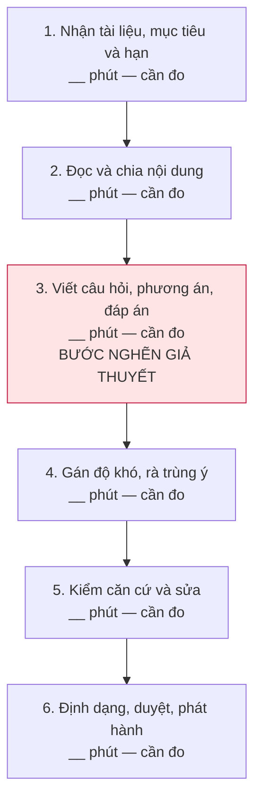
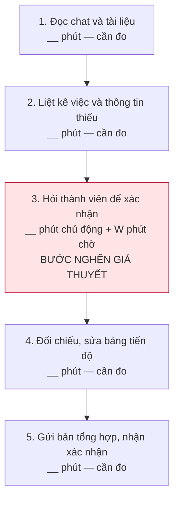
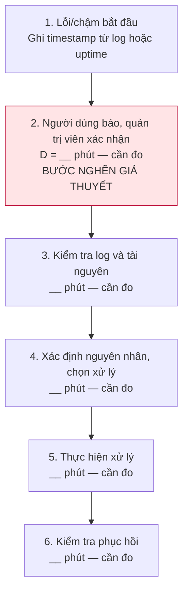

# Báo cáo cá nhân — Lê Thanh Tùng — 2A202603819

> Cập nhật ngày 09/11/2026: phần này gồm 5 vấn đề tôi đưa ra, 3 Problem Card để chuẩn bị trao đổi và nguồn tham khảo. Nhóm chưa họp nên nhật ký tham gia nhóm và reflection sẽ bổ sung sau.

## 1. Thông tin học viên

- Họ tên: Lê Thanh Tùng.
- MSSV: 2A202603819.
- Tên nhóm: Văn Minh — theo tên repo.
- Link repo nhóm: https://github.com/TuHoAnh/K5-L3B-DAY02-VanMinh-DiscoveryProblemFraming.

## 2. Scan problem (CP1)

Tôi đưa ra 5 vấn đề liên quan đến học tập trực tuyến, đào tạo, lập trình và làm việc nhóm. Tôi muốn làm rõ ai gặp khó khăn, nghẽn ở bước nào và có thể đo bằng gì trước khi nghĩ đến cách giải quyết.

Các con số dưới đây lấy từ nguồn công khai để tham khảo. Tôi chưa có số đo trong từng bối cảnh cụ thể; thông số sản phẩm hoặc kết quả của một nghiên cứu không thay cho số liệu của cộng đồng hay dự án đang xét.

| # | Lăng kính | Job Story: Khi… tôi muốn… để… | Ai chịu ảnh hưởng? | Dấu hiệu và nguồn tham khảo |
|---:|---|---|---|---|
| 1 | Pain từ người khác | **Gian lận thời gian trong cộng đồng học tập.** Khi quản lý một cộng đồng có xếp hạng giờ học và nhận báo cáo treo máy, tôi muốn xác minh phiên bị phản ánh theo nội quy, để giữ công bằng cho người học thật và tránh xử lý nhầm. | Quản trị viên và thành viên cộng đồng. | [Study Together](https://www.studytogether.com/faq) có quy định chống farming. Tính năng check-in mục tiêu nhắc sau **2 giờ**, chuyển AFK nếu không trả lời trong **10 phút**, nhưng không áp dụng cho phòng camera/màn hình. Nguồn này cho thấy đã có quy định xử lý vấn đề, chưa cho biết tỷ lệ vi phạm hay số giờ quản trị viên phải kiểm tra. |
| 2 | Tốn thời gian; Cần đọc, tổng hợp nhiều thông tin | **Tốn thời gian tạo đề kiểm tra.** Khi có tài liệu nghiệp vụ hoặc bài giảng mới, tôi muốn soạn được bộ 50 câu hỏi có đáp án và độ khó phù hợp, để đánh giá đúng nội dung người học cần nắm và phát hành kịp thời. | Giảng viên, chuyên viên đào tạo nội bộ. | [Nghiên cứu PAFMJ, công bố 2026](https://www.pafmj.org/PAFMJ/article/view/12930) ghi nhận hai giảng viên tạo **50 câu trong 205 phút**, bộ ChatGPT mất **25 phút**; **100 sinh viên y** làm hai bộ. Đây là thời gian tạo câu hỏi trong một nghiên cứu y khoa, chưa tính quy trình duyệt bộ đề để phát hành. |
| 3 | Tốn thời gian; Cần đọc, tổng hợp nhiều thông tin | **Kẹt khi fix bug ban đêm.** Khi tự học hoặc làm dự án vào ban đêm và gặp lỗi logic chưa hiểu nguyên nhân, tôi muốn khoanh vùng lỗi trong ngữ cảnh code hiện tại, để tiếp tục tính năng và kiểm tra được bản sửa. | Lập trình viên độc lập, sinh viên CNTT. | [Stack Overflow Survey 2022](https://survey.stackoverflow.co/2022/#professional-developers-productivity-impacts): mục này có **36.198** phản hồi; khoảng **62%** dành trên **30 phút/ngày** tìm câu trả lời hoặc lời giải. Số này tính cả hỏi và chờ đồng nghiệp, không chỉ debug và không riêng ban đêm. |
| 4 | Pain từ người khác; Tốn thời gian | **VPS gặp sự cố nhưng phát hiện muộn.** Khi web hoặc bot chạy trên VPS bị chậm hay gián đoạn, tôi muốn nhận biết dấu hiệu bất thường sớm, để bắt đầu xử lý trước khi phải chờ người dùng nhắn báo. | Người vận hành dự án và người dùng dịch vụ. | [Cloudflare, sự cố ngày 02/07/2019](https://blog.cloudflare.com/details-of-the-cloudflare-outage-on-july-2-2019/): cạn CPU gây gián đoạn **27 phút**, cảnh báo tự động đầu tiên sau **3 phút** từ lúc triển khai. Đây là hệ thống lớn, không phải baseline cho VPS nhỏ; case này cũng cho thấy có thể phát hiện bằng giám sát tự động. |
| 5 | Lặp lại; Cần đọc, tổng hợp nhiều thông tin | **Trôi thông tin và lệch tiến độ nhóm.** Khi việc giao task và cập nhật tiến độ nằm trong nhóm chat, tôi muốn biết rõ ai làm gì, hạn nào và đang đến đâu, để tránh bỏ sót, làm trùng hoặc hiểu sai công việc. | Trưởng nhóm và các thành viên dự án. | [Asana Anatomy of Work 2022](https://investors.asana.com/node/6631/pdf): GWI khảo sát **10.624 lao động tri thức tại 7 quốc gia**; **58%** ngày làm việc dành cho điều phối. Phạm vi này rộng hơn hỏi tiến độ qua chat, không thể coi toàn bộ là lãng phí hay áp thẳng cho nhóm sinh viên. |

Một số điểm cần kiểm tra thêm:

- **Giờ học:** bật camera hoặc ít chuyển động chưa đủ để kết luận đang học hay gian lận. Cần biết cộng đồng quy định thế nào và quản trị viên xác minh report ra sao.
- **Tạo đề:** cần xác định khâu tốn nhất là đọc tài liệu, viết câu hỏi hay rà sửa; đồng thời kiểm tra người soạn đã dùng ngân hàng câu hỏi chưa.
- **Debug:** nên chọn một lỗi tái hiện được để theo dõi. Chưa có bằng chứng rằng ban đêm là nguyên nhân gây kẹt hoặc câu trả lời trên mạng luôn không phù hợp.
- **VPS:** cần tách thời gian phát hiện khỏi thời gian chẩn đoán và khôi phục. CPU/RAM cao chưa chắc là nguyên nhân duy nhất.
- **Tiến độ nhóm:** cần phân biệt thông tin khó tổng hợp với việc thành viên chưa cập nhật. Nếu đầu vào còn thiếu thì thêm công cụ chưa chắc giúp được.

## 3. Top 3 Problem Cards + quy trình nháp (CP2)

### Ba vấn đề chuẩn bị để trao đổi

Đây là danh sách tạm cho CP2, chưa phải lựa chọn chung của nhóm.

| Thứ tự | Vấn đề | Lý do đưa vào | Điều còn chưa rõ |
|---:|---|---|---|
| 1 | #2 — Soạn bộ đề từ tài liệu mới | Có đầu vào là tài liệu và đầu ra là bộ câu hỏi; có thể kiểm cả thời gian lẫn chất lượng. | Bước nào thực sự tốn nhất? Việc sửa và duyệt câu hỏi mất bao lâu? |
| 2 | #5 — Tổng hợp tiến độ qua chat | Có thể lần theo tin nhắn, task và các lần phải hỏi lại để tìm chỗ nghẽn. | Trễ việc do thông tin bị trôi hay do quá tải, phụ thuộc công việc khác? |
| 3 | #4 — Phát hiện muộn sự cố VPS | Có thể đối chiếu thời điểm lỗi, cảnh báo và lúc bắt đầu xử lý qua log. | Dự án đã có monitoring chưa? Có dữ liệu trước lúc người dùng báo không? |

Hai ý còn lại vẫn được giữ trong bảng scan. Với giờ học, cần làm rõ tiêu chí xác minh công bằng. Với debug, cần thu hẹp vào một loại lỗi và một lần xử lý cụ thể.

### Problem Card #1 — Tạo đề kiểm tra từ tài liệu mới

| Trường | Nội dung |
|---|---|
| Job Story | Khi có tài liệu nghiệp vụ hoặc bài giảng mới, tôi muốn soạn được 50 câu hỏi có đáp án và độ khó phù hợp, để đánh giá đúng nội dung cần học và phát hành kịp thời. |
| Actor | Giảng viên hoặc chuyên viên đào tạo phụ trách soạn đề; người có chuyên môn duyệt nội dung. |
| Thời điểm / bối cảnh | Tài liệu và mục tiêu học tập đã có, cần hoàn thành một bộ đề trước buổi đào tạo. |
| Quy trình hiện tại (3–7 bước) | Nhận tài liệu → Đọc, chọn nội dung cần kiểm tra → Viết câu hỏi và đáp án → Rà độ khó, trùng ý → Kiểm căn cứ và sửa → Duyệt, phát hành. |
| Bottleneck (bước nào, mất bao nhiêu phút) | Dự kiến ở bước viết câu hỏi: phải chuyển ý chính thành câu hỏi có phương án nhiễu hợp lý. **Chưa đo số phút/bộ đề**; cần kiểm tra xem khâu rà sửa có tốn hơn không. |
| Impact (nếu không giải thì sao) | Đề phát hành muộn, mất thêm công sửa, hoặc có câu hỏi nông, lặp ý, sai đáp án. |
| Success metric (baseline → target) | Gọi T50 là tổng phút để có **50 câu được duyệt**, gồm cả sửa. Baseline chưa đo; mục tiêu đề xuất là **≤70% T50** trên tài liệu tương đương. Ghi thời gian từng bước và thời gian chờ riêng; kiểm cả đáp án, căn cứ và độ phủ, không chỉ đếm số câu tạo ra. Sau duyệt, mục tiêu là **0 câu sai đáp án hoặc không có căn cứ**. |
| Phương án không dùng AI | Dùng ma trận nội dung × mục tiêu × độ khó, mẫu câu hỏi, checklist và ngân hàng câu hỏi đã duyệt. |
| Giả thuyết về AI (nếu có) | Hỗ trợ tạo nháp từ tài liệu, kèm đoạn làm căn cứ. Người có chuyên môn vẫn kiểm và duyệt. Cần tính cả công sửa để biết có tiết kiệm thời gian thật không. |
| Cảm nhận nhanh | Chưa chốt. Thử template/ngân hàng câu hỏi trước; cân nhắc Workflow nếu khâu soạn nháp vẫn nghẽn. |

Quy trình nháp; số phút từng bước sẽ bổ sung sau khi đo:

Tổng thời gian chủ động T50 gồm 6 bước và các vòng sửa lại. Thời gian chờ duyệt ghi riêng. Mốc 205 phút trong nghiên cứu ở CP1 chỉ dùng tham khảo khâu tạo câu hỏi.

### Problem Card #2 — Trôi thông tin và lệch tiến độ nhóm

| Trường | Nội dung |
|---|---|
| Job Story | Khi giao task và cập nhật tiến độ qua chat, tôi muốn biết rõ ai phụ trách, hạn nào và trạng thái đã được xác nhận, để tránh bỏ sót, làm trùng và báo cáo sai tiến độ. |
| Actor | Trưởng nhóm tổng hợp; thành viên xác nhận công việc của mình. |
| Thời điểm / bối cảnh | Một lần chốt tiến độ của nhóm dự án dùng chat để giao việc và thay đổi yêu cầu. Quy mô, tần suất và công cụ cụ thể chưa được ghi nhận. |
| Quy trình hiện tại (3–7 bước) | Đọc lại chat/tài liệu → Lập danh sách việc và thông tin thiếu → Hỏi từng người → Đối chiếu, sửa bảng tiến độ → Gửi tổng hợp và nhận xác nhận. |
| Bottleneck (bước nào, mất bao nhiêu phút) | Dự kiến ở bước hỏi lại để xác nhận người phụ trách, deadline và trạng thái. **Chưa đo phút/lần chốt**; thời gian chờ trả lời W được ghi riêng. |
| Impact (nếu không giải thì sao) | Trưởng nhóm mất công nhắc và gom thông tin; thành viên có thể làm trùng hoặc bỏ sót việc. Cần kiểm từng task trễ để xác định phần thực sự do thiếu thông tin. |
| Success metric (baseline → target) | Tổng phút chủ động cập nhật mỗi tuần T: chưa đo → mục tiêu đề xuất **≤70% T** trong đợt thử 2 tuần. Theo dõi lượt hỏi lại/task; mục tiêu **100% task đến hạn có người phụ trách và deadline được xác nhận**, số trạng thái ghi sai sau kiểm tra không tăng. |
| Phương án không dùng AI | Một bảng task chung, quy định rõ nơi cập nhật, người phụ trách và hạn chót; chốt tiến độ theo mẫu ngắn. |
| Giả thuyết về AI (nếu có) | Nếu thông tin đã có nhưng đọc và tổng hợp vẫn lâu, có thể tạo nháp cập nhật kèm link tin nhắn gốc. Thành viên xác nhận trước khi dùng; không tự suy diễn đã xong việc hoặc tự đổi deadline. |
| Cảm nhận nhanh | No AI trước. Chỉ cân nhắc Workflow nếu đã thống nhất cách cập nhật mà vẫn mất nhiều công tổng hợp. |

Quy trình nháp:

Công chủ động mỗi lần chốt là tổng 5 bước. W là thời gian chờ phản hồi, không tính toàn bộ W thành giờ làm việc của trưởng nhóm. Muốn quy đổi theo tuần cần biết tần suất thực tế.

### Problem Card #3 — Phát hiện muộn sự cố VPS

| Trường | Nội dung |
|---|---|
| Job Story | Khi web hoặc bot chạy trên VPS bị chậm hay gián đoạn, tôi muốn nhận biết dấu hiệu bất thường sớm, để bắt đầu xử lý trước khi phải chờ người dùng nhắn báo. |
| Actor | Người vận hành dự án; người dùng chịu ảnh hưởng khi dịch vụ chậm hoặc không truy cập được. |
| Thời điểm / bối cảnh | Dịch vụ trên VPS gặp lỗi hoặc phản hồi chậm vào thời điểm tải tăng. Cấu hình và nguyên nhân thực tế cần kiểm qua log. |
| Quy trình hiện tại (3–7 bước) | Dịch vụ chậm/lỗi → Người dùng báo, quản trị viên nhận biết → Kiểm log và tài nguyên → Xác định nguyên nhân → Xử lý → Kiểm tra phục hồi. |
| Bottleneck (bước nào, mất bao nhiêu phút) | Dự kiến ở khoảng chờ nhận biết sự cố. **D = thời điểm quản trị viên xác nhận − thời điểm đầu tiên log/kiểm tra uptime ghi nhận ảnh hưởng**. Baseline chưa đo; nếu thiếu log trước lúc người dùng báo thì chưa tính D đáng tin cậy được. |
| Impact (nếu không giải thì sao) | Bắt đầu xử lý muộn, kéo dài ảnh hưởng đến người dùng. Cần tách phần chậm phát hiện khỏi thời gian sửa lỗi. |
| Success metric (baseline → target) | D chưa đo → mục tiêu đề xuất **≤5 phút** khi có giám sát và người nhận cảnh báo. Theo dõi thêm downtime/30 ngày, latency p95 cùng khung giờ và cảnh báo không cần hành động/ngày; mục tiêu thử nghiệm cho chỉ số cuối là **≤1/ngày**. |
| Phương án không dùng AI | Kiểm tra uptime từ bên ngoài, theo dõi CPU/RAM/disk và lỗi ứng dụng; cảnh báo theo ngưỡng kéo dài tới người phụ trách, kèm checklist xử lý. |
| Giả thuyết về AI (nếu có) | Có thể hỗ trợ đọc/tóm tắt log nếu khâu chẩn đoán được xác định là nghẽn. Chưa cần dùng cho cảnh báo theo ngưỡng; chưa có căn cứ đề xuất tự nâng cấu hình hoặc tự khởi động lại. |
| Cảm nhận nhanh | Rule trước: monitoring và cảnh báo có thể đủ cho phần phát hiện. |

Quy trình nháp:

Thời gian đến lúc phục hồi gồm cả phát hiện và xử lý. Downtime chỉ tính khoảng dịch vụ không phục vụ được, không mặc định toàn bộ thời gian kiểm tra là downtime.

[DigitalOcean Monitoring Quickstart](https://docs.digitalocean.com/products/monitoring/getting-started/quickstart/) có cảnh báo theo ngưỡng với khoảng duy trì **5, 10, 30 phút hoặc 1 giờ**. Để thử mục tiêu D ≤5 phút cần chọn cửa sổ phù hợp và tính cả độ trễ nhận cảnh báo.

### Card dự kiến trao đổi trước

- Card #1 — tạo đề kiểm tra: có đầu ra cụ thể để xem xét cả thời gian lẫn chất lượng.
- Thứ tự này đang để chuẩn bị, có thể thay đổi sau khi kiểm tra dữ liệu và trao đổi với nhóm.
- Câu hỏi muốn nhóm phản biện: _Bổ sung khi chuẩn bị pitch._

### Phản biện bằng AI và điều chỉnh trong bản nháp

| Nhận xét | Điều chỉnh trong bản nháp | Việc cần kiểm tra tiếp |
|---|---|---|
| Tạo đề nhanh hơn chưa chắc có lợi nếu phải sửa nhiều. | Đo tổng công để có 50 câu được duyệt, thêm kiểm đáp án, căn cứ và độ phủ. | Ghi riêng thời gian soạn và sửa. |
| Tiến độ nhóm có thể vướng ở cách cập nhật, không phải ở công cụ. | Thêm phương án bảng task chung và quy ước cập nhật; tách công chủ động khỏi thời gian chờ. | Xem thông tin đã có nhưng khó tìm hay chưa được cung cấp. |
| VPS đang gộp phát hiện với chẩn đoán và khôi phục. | Dùng D cho phần phát hiện, ghi downtime riêng và so sánh phương án Rule. | Kiểm tra log và cảnh báo đang có. |
| Số liệu bên ngoài chưa phải baseline của các tình huống đang xét. | Giữ nguồn, ghi rõ giới hạn và để phần chưa đo thay vì gán số. | Bổ sung số đo trực tiếp trước khi chốt mục tiêu. |

## 4. Tôi đã tham gia phần nào (bổ sung sau hoạt động nhóm)

Nhóm chưa họp. Phần này sẽ ghi lại đóng góp và các câu hỏi trao đổi ở CP3–CP6 sau khi thực hiện. Hiện tại tôi chuẩn bị CP1–CP2 để đưa ra thảo luận.

Khung nhật ký để bổ sung sau buổi nhóm

Phản biện bằng AI ở CP2 được ghi riêng ở mục 3; các câu hỏi giữa thành viên ở CP3 sẽ ghi tại đây.

| Hoạt động | Trạng thái | Nội dung sẽ bổ sung |
|---|---|---|
| Chuẩn bị cá nhân | Đã đưa ra 5 vấn đề; có bản nháp scan, card và nguồn tham khảo. | Các điều chỉnh sau khi kiểm tra thực tế. |
| Pitch Problem Card | Chưa thực hiện. | Card đã trình bày và phản hồi nhận được. |
| Phản biện bài của bạn khác | Chưa thực hiện. | Câu hỏi đã đặt và ảnh hưởng tới bài của bạn. |
| Nhận phản biện từ thành viên | Chưa thực hiện. | Câu hỏi nhận được và điều đã sửa. |
| Gom cluster / cây OST | Chưa thực hiện. | Phần tham gia và liên kết báo cáo nhóm. |
| Chọn candidate problem | Nhóm chưa chọn. | Vấn đề được chọn, lý do và phần đóng góp. |
| Kiểm chứng / research | Có nguồn tham khảo trong memo; chưa phỏng vấn/survey. | Nguồn đã tự kiểm và kết quả hỏi người thật. |
| Quy trình nhóm | Chưa thực hiện. | Đóng góp ở CP5; các sơ đồ trên mới dùng cho từng card. |
| Problem Statement | Chưa thực hiện. | Phần tham gia và thay đổi từ v0 sang v1. |
| Mức can thiệp AI | Chưa chốt trong nhóm. | Mức được chọn và lập luận. |
| Quyết định | Nhóm chưa quyết định. | Go / Not Yet / No-Go và căn cứ. |

## 5. Dùng AI

Tôi đưa ra 5 mô tả ban đầu. Trong phần chuẩn bị, tôi dùng AI để biên tập Job Story, gợi ý thứ tự 3 card, dựng sơ đồ, phản biện và tìm nguồn. Các nội dung này vẫn cần kiểm lại với quy trình thực tế.

| Phần | Tôi dùng AI để làm gì? | Hữu ích ở đâu? | Hạn chế hoặc chỗ cần sửa | Điều tôi đã yêu cầu chỉnh / cần làm tiếp |
|---|---|---|---|---|
| CP1 | Sắp xếp 5 mô tả theo mẫu Job Story. | Làm rõ bối cảnh, người gặp vấn đề và kết quả mong muốn. | Có thể diễn giải rộng hơn mô tả ban đầu. | Giữ 5 vấn đề tôi đã đưa ra; đối chiếu lại cách diễn đạt. |
| CP2 | Gợi ý thứ tự top 3, biên tập card, dựng sơ đồ và phản biện. | Chỉ ra cần đo cả công sửa đề, tách thời gian chờ và thời gian phát hiện lỗi. | Thứ tự ưu tiên và bước nghẽn mới là giả thuyết, chưa qua kiểm chứng. | Kiểm lại quy trình và thứ tự trước khi pitch. |
| Nguồn tham khảo | Tôi yêu cầu AI tự tìm số liệu công khai. | Có 8 nguồn kèm phạm vi áp dụng trong memo. | Không tìm được tỷ lệ gian lận giờ học hoặc baseline VPS nhỏ phù hợp; số liệu ngoài không phải số đo của tôi. | Mở lại nguồn sẽ dùng và bổ sung dữ liệu trực tiếp. |
| Biên tập bài | Nhờ sửa cách trình bày sau khi đọc bản đầu. | Có thể rút câu và thống nhất cách xưng hô. | Bản đầu lặp “học viên”, “trợ lý”, đọc giống hướng dẫn hơn bài cá nhân. | Tôi yêu cầu viết tự nhiên hơn, làm rõ ý tưởng ban đầu là của tôi và ghi đúng phần AI hỗ trợ. |
| CP4–CP6 | Chưa thực hiện phần nhóm. | — | Chưa có phỏng vấn, Problem Statement hay quyết định chung. | Bổ sung sau khi thực hiện. |

## 6. Reflection (CP7 — bổ sung sau hoạt động nhóm)

Chưa viết vì nhóm chưa họp. Tôi sẽ trả lời bằng trải nghiệm sau khi làm nhóm, tối thiểu 200 từ cho các câu 6.1–6.6; câu 6.7 ghi riêng.

Các câu hỏi reflection theo mẫu

**6.1. Tôi học được gì khi nghe top 3 problems của các bạn khác?**

_Bổ sung sau buổi làm nhóm._

**6.2. Nhóm có lúc nào bị “solution-first” (nghĩ giải pháp trước khi hiểu vấn đề) không? Lúc đó nhóm nhận ra và xử lý thế nào?**

_Bổ sung sau buổi làm nhóm._

**6.3. Tôi có đổi ý sau khi bị phản biện không? Kể một lần cụ thể.**

_Bổ sung sau buổi làm nhóm._

**6.4. Kết quả kiểm chứng (phỏng vấn/survey/research) có làm tôi bất ngờ không? Điều gì?**

_Bổ sung sau buổi làm nhóm._

**6.5. Điều khó nhất khi viết Problem Statement là gì?**

_Bổ sung sau buổi làm nhóm._

**6.6. Nếu làm lại, tôi sẽ đổi gì? Tôi sẽ phản biện nhóm mạnh hơn ở điểm nào?**

_Bổ sung sau buổi làm nhóm._

**6.7. Hiểu bài:** giải thích bằng 5–8 câu, không nhìn tài liệu, chuỗi *problem → quy trình → metric → boundary → mức can thiệp AI → quyết định* của bài nhóm mình.

_Bổ sung sau khi nhóm có quyết định._

## 7. Tài liệu tham khảo

- Năm mô tả vấn đề tôi đưa ra ngày 09/11/2026.
- [README](../../README.md), [CHECKPOINTS](../../CHECKPOINTS.md) và [Worksheet](../../docs/01-worksheet.md).
- [Rubric](../../RUBRIC.md) và [Rules](../../RULES.md).
- [Nguồn tham khảo cho 5 vấn đề và giới hạn áp dụng](../assets/cp1-2-evidence-research.md).
