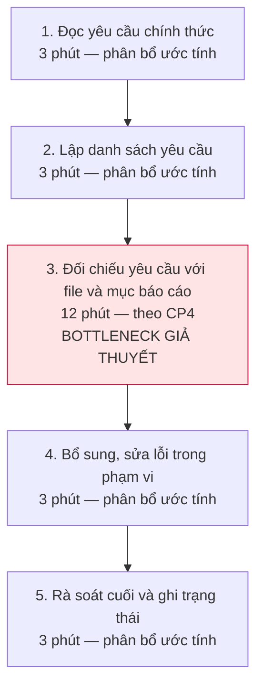
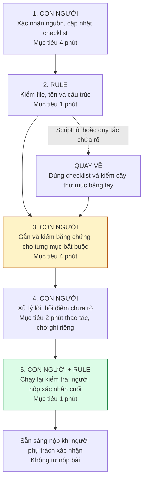

# Báo cáo nhóm — Day 02 Discovery & Problem Framing

> Bản chung của nhóm, viết trên repo do nhóm trưởng fork. Không copy file này sang repo cá nhân.
> Template chi tiết và prompt mẫu: [docs/01-worksheet.md](../../docs/01-worksheet.md). Bài mẫu: [docs/02-deliverable-example.md](../../docs/02-deliverable-example.md).

## 1. Thông tin nhóm

- Tên nhóm:
- Thành viên: xem `TEAM.md`
- Candidate problem được chọn (1 câu):
- Quyết định cuối: Go / Not Yet / No-Go

---

## 2. Hội tụ nhóm (CP3)

### 2.1. Pitch

| # | Người đưa ra | Candidate (Job Story ngắn) | Actor | Bottleneck | Câu hỏi phản biện nhận được (ai hỏi) |
|---:|---|---|---|---|---|
| 1 | | | | | |
| 2 | | | | | |
| 3 | | | | | |
| 4 | | | | | |
| 5 | | | | | |
| 6 | | | | | |
| 7 | | | | | |
| 8 | | | | | |
| 9 | | | | | |
| 10 | | | | | |
| 11 | | | | | |
| 12 | | | | | |

### 2.2. Cluster

| Cluster | Các candidate | Pattern chung |
|---|---|---|
| A | | |
| B | | |
| C | | |

### 2.3. Opportunity Solution Tree rút gọn

Gốc là **1 outcome**. Nhánh là **opportunity** (nhu cầu, pain), không phải tính năng hay công cụ.

```text
OUTCOME: 
├── Opportunity A: 
├── Opportunity B: 
└── Opportunity C: 
```

Những ý đã gạch bỏ vì là solution đội lốt opportunity:

-

### 2.4. Chấm điểm shortlist (1–5)

| Candidate | Actor rõ | Quy trình rõ | Pain có bằng chứng | Impact đo được | Vừa sức lab | So sánh được No AI/Rule/Workflow/Agent | Nhóm hiểu domain | Tổng |
|---|---:|---:|---:|---:|---:|---:|---:|---:|
| | | | | | | | | |
| | | | | | | | | |
| | | | | | | | | |

**Candidate được chọn:**

**Vì sao chọn:**

**Vì sao loại các candidate còn lại:**

**Xử lý bất đồng (nếu có):**

---

## 3. Kiểm chứng + research giải pháp đã có (CP4)

### 3.1. Assumption Map

| # | Giả định | Loại (Value / Usability / Feasibility / Viability) | Quan trọng (1–5) | Đã có bằng chứng (1–5) | Kiểm chứng trước? |
|---:|---|---|---:|---:|---|
| 1 | | | | | |
| 2 | | | | | |
| 3 | | | | | |
| 4 | | | | | |
| 5 | | | | | |
| 6 | | | | | |

*Điền 4–6 giả định; xóa dòng thừa.*

Giả định nhóm kiểm chứng trong buổi này:

### 3.2. Kiểm chứng

Cách đã dùng: Phỏng vấn / Survey / Log, ticket, review

Interview snapshot (mỗi buổi phỏng vấn một bảng, hoặc đặt file trong `report/assets/cp4-interview-snapshot-N.md`):

| Trường | Nội dung |
|---|---|
| Người được hỏi (vai trò, không ghi tên thật) | |
| Câu nói đáng nhớ nhất (nguyên văn) | |
| Lần gần nhất gặp vấn đề này: chuyện gì đã xảy ra? | |
| Hiện đang xử lý bằng cách nào (workaround)? | |
| Mất bao lâu, bao lần? | |
| Insight / opportunity rút ra | |

Tổng hợp:

| Nguồn | Số người / số mẫu | Tín hiệu xác nhận | Tín hiệu phản bác |
|---|---:|---|---|
| | | | |

**Nhóm đã sửa problem thế nào sau kiểm chứng:**

### 3.3. Research giải pháp đã có

| Công cụ / case / pattern | Link | Giải bước nào trong quy trình? | Điểm mạnh | Khoảng trống / rủi ro | Bài học cho nhóm |
|---|---|---|---|---|---|
| | | | | | |
| | | | | | |
| | | | | | |

---

## 4. Quy trình trước/sau (CP5)

> Người tổng hợp: Vũ Văn Bình. Dựa trên candidate và phạm vi CP4 tại [nhánh nguyennamkhanh, commit bd8c710](https://github.com/TuHoAnh/K5-L3B-DAY02-VanMinh-DiscoveryProblemFraming/blob/bd8c710e3eb5456b69e37236a2cebffdf55e39c2/report/team/group_report.md). Chỉ xét thiếu file, sai tên/cấu trúc và thiếu mục nội dung bắt buộc; không chấm chất lượng chuyên môn. Các mốc 24, 4 và 31 phút được trích theo nội dung CP4, chưa được xác minh độc lập trong CP5. Phân bổ chi tiết các bước chưa có trong CP4 được ghi là ước tính; thời gian tương lai là mục tiêu đề xuất, chưa phải kết quả đạt được.

### 4.1. Quy trình hiện tại

Phạm vi đo: bắt đầu khi đã có bản bài làm cần kiểm tra và bộ yêu cầu; kết thúc khi có bản kiểm tra cuối sẵn sàng nộp. Ghi riêng thời gian chờ trợ giảng và thao tác upload/push/LMS; không tính thời gian viết toàn bộ bài hoặc sửa lỗi chuyên môn ngoài phạm vi.

Sơ đồ quy trình hiện tại — **24 phút theo snapshot thứ nhất ở CP4**; mốc tham chiếu của một trường hợp, không phải trung bình của cả nhóm:



| Bước | Actor | Input | Output | Thời gian / tần suất | Ghi chú |
|---:|---|---|---|---|---|
| 1 | Học viên phụ trách nộp bài | README, SUBMISSION, rubric và cập nhật chính thức | Danh sách nguồn đang áp dụng; điểm mâu thuẫn cần hỏi | Ước tính phân bổ 3 phút/lần nộp | Cùng bước 2 tạo nhóm “gom yêu cầu” 6 phút theo snapshot thứ nhất ở CP4. Không tự chọn giữa hai hướng dẫn mâu thuẫn. |
| 2 | Học viên phụ trách nộp bài | Bộ yêu cầu ở bước 1 | Checklist gồm yêu cầu, nguồn, vị trí bằng chứng dự kiến | Ước tính phân bổ 3 phút/lần nộp | Chưa có đo riêng bước 1 và 2; cách chia 3 + 3 chỉ dùng để mô tả quy trình. |
| 3 | Học viên phụ trách nộp bài | Checklist và bản bài làm | Trạng thái từng yêu cầu: có, thiếu, chưa rõ; đường dẫn file/tiêu đề | Theo CP4: 12 phút/lần nộp | Bottleneck giả thuyết: tìm đúng bằng chứng cho từng yêu cầu, không chỉ kiểm file tồn tại. |
| 4 | Người viết phần liên quan; học viên tổng hợp | Danh sách lỗi/thiếu đã xác nhận | File, tên, cấu trúc hoặc mục nội dung đã bổ sung | Ước tính phân bổ 3 phút/lần nộp | Chỉ sửa lỗi trong phạm vi. Nếu phải viết lại nội dung chuyên môn thì ghi riêng công việc đó. |
| 5 | Học viên chịu trách nhiệm nộp | Bản đã sửa và checklist | Checklist kiểm tra cuối, bản bài làm được người nộp xác nhận | Ước tính phân bổ 3 phút/lần nộp | Cùng bước 4 tạo nhóm “bổ sung và kiểm tra cuối” 6 phút theo snapshot thứ nhất ở CP4. |

**Bottleneck chính:** bước 3 — đối chiếu từng yêu cầu với đúng file hoặc mục nội dung, chiếm 12/24 phút theo snapshot thứ nhất ở CP4. CP5 chưa có phép đo độc lập cho bước này. Cần phân biệt “đã có mục phân tích” với “phân tích đủ tốt”: CP5 chỉ xử lý sự hiện diện của mục bắt buộc và quy cách đã xác định.

CP4 còn ghi trường hợp kiểm checklist chỉ 4 phút và trường hợp 31 phút thao tác + 20 phút chờ trợ giảng. Không lấy trung bình ba trường hợp do phạm vi công việc khác nhau; không áp mốc 24 phút cho mọi học viên. Lỗi notebook và thời gian chạy lại không thuộc bài toán đang chọn.

### 4.2. Quy trình tương lai

Phương án đề xuất để thử: checklist tập trung, gắn bằng chứng và Rule cho điều kiện đúng/sai rõ. **Chưa chốt mức can thiệp ở CP6**; chưa cần bước AI tạo hoặc đánh giá nội dung. Nhóm có thể thử checklist thủ công trước; chỉ thêm script khi lợi ích đo được đủ bù công thiết lập.



Các thời gian sau là **mục tiêu thiết kế**, chưa phải kết quả đạt được; tổng 12 phút không gồm công tạo script/checklist lần đầu, chờ phản hồi hoặc nộp bài. Các vòng kiểm lại phát sinh đều phải tính vào thời gian thao tác thực tế.

| Bước | Actor / mức xử lý | Input | Output | Thời gian / tần suất | Điểm kiểm soát |
|---:|---|---|---|---|---|
| 1 | Con người | Nguồn yêu cầu chính thức và checklist mẫu | Checklist phiên bản hiện tại: yêu cầu, nguồn, bằng chứng, trạng thái | Mục tiêu 4 phút/lần nộp | Người nộp kiểm tra thay đổi; yêu cầu chưa rõ được đánh dấu, không tự diễn giải thành quy tắc mới. |
| 2 | Rule/script | Checklist quy cách đã xác nhận và toàn bộ cây thư mục bài nộp | Báo cáo file thiếu, sai tên hoặc sai cấu trúc, kèm quy tắc áp dụng | Mục tiêu 1 phút/lượt | Script đọc toàn bộ cây thư mục, không chỉ file vừa sửa; không tự đổi tên/xóa/sửa nội dung. |
| 3 | Con người | Checklist, báo cáo Rule và bài làm | Liên kết mỗi mục bắt buộc tới file/tiêu đề/đoạn; đánh dấu có, thiếu hoặc chưa rõ | Mục tiêu 4 phút/lượt | Kiểm tra đoạn liên kết thực sự có nội dung; tiêu đề rỗng không đủ. Không suy ra đạt chất lượng từ việc mục đó tồn tại. |
| 4 | Người viết phần liên quan; người nộp điều phối | Danh sách thiếu/sai/chưa rõ | Bản sửa; câu hỏi gửi trợ giảng nếu cần | Mục tiêu 2 phút thao tác/lượt | Người viết tự bổ sung. Nếu cần sửa lớn thì vượt target và được ghi nhận, không bỏ qua để đạt thời gian. |
| 5 | Con người + Rule/script | Bản cuối, checklist và các thay đổi sau bước 4 | Báo cáo kiểm lại; người nộp xác nhận trạng thái cuối | Mục tiêu 1 phút/lượt | Kiểm lại trên bản cuối. Chỉ người chịu trách nhiệm mới quyết định nộp. |

**Boundary:**

- Chỉ sử dụng bộ yêu cầu chính thức đã được người nộp xác nhận; không tự đặt tiêu chí, bỏ tiêu chí hoặc suy đoán điểm số.
- Rule chỉ kiểm các điều kiện xác định được. Không biến “script chạy đạt” thành “bài đạt rubric” hay “được điểm cao”.
- Không có bước AI trong phương án hiện tại. Nếu CP6 bổ sung AI thì chỉ dùng trong phạm vi được môn học cho phép, kết quả phải có nguồn và được người nộp kiểm tra; không viết thay phần bắt buộc tự làm.
- Không tự sửa/xóa bài, không tự commit, push hoặc nộp LMS. Người viết sửa nội dung; người nộp xác nhận bản cuối.
- Yêu cầu mâu thuẫn hoặc mơ hồ phải chuyển cho giảng viên/trợ giảng xác nhận; phần đánh giá chất lượng chuyên môn nằm ngoài phạm vi kiểm tự động.

**Phương án quay về:** nếu script không chạy, báo sai hoặc chưa cập nhật đúng quy định, người nộp bỏ kết luận tự động và kiểm toàn bộ checklist cùng cây thư mục bằng tay. Nếu thiếu nguồn yêu cầu, quay lại bước 1; nếu tiêu chí chưa rõ, hỏi trợ giảng và ghi riêng thời gian chờ. Sau khi sửa vẫn phải rà bản cuối; không đánh dấu đạt để kịp target.

### 4.3. Before / after

| Chỉ số | Trước | Sau (kỳ vọng) | Ghi chú |
|---|---:|---:|---|
| Số bước xử lý chính | 5 | 5 | Giảm công đối chiếu, không đặt mục tiêu giảm số bước bằng cách bỏ kiểm tra. |
| Tổng thời gian thao tác | 24 phút theo CP4 | Mục tiêu ≤12 phút/lần nộp | Mức cải thiện dự kiến 50% so với mốc tham chiếu 24 phút; cần đo lại khi thử nghiệm. Trước: 3+3+12+3+3; sau: 4+1+4+2+1. Không gồm chờ và công thiết lập lần đầu. |
| Số bước thủ công | 5/5 | 4/5 có con người tham gia | Bước 2 chạy Rule; bước 5 kết hợp Rule và con người, vẫn tính là có thao tác thủ công. |
| Bottleneck chính | Đối chiếu yêu cầu với bằng chứng: 12 phút theo CP4 | Xác nhận yêu cầu và kiểm bằng chứng: mục tiêu 4 phút/bước | Chưa đo quy trình sau; vẫn giữ người kiểm ở các bước cần hiểu yêu cầu. |
| Rủi ro mới phát sinh | Chưa có kết luận tự động để dựa vào | Checklist/script cũ, báo đạt sai hoặc bỏ sót mục nội dung | Xác nhận phiên bản, dẫn nguồn yêu cầu, người kiểm bản cuối và quay về kiểm thủ công. |
| Chất lượng cần giữ | Chưa có tỷ lệ lỗi thực tế | Không tăng lỗi thiếu mục/sai quy cách; phát hiện đủ lỗi bắt buộc trên bộ thử đã xác nhận | Mục tiêu, chưa có kết quả. Không đo bằng điểm số do giảng viên chưa chấm. |

---

## 5. Problem Statement v0 (CP5)

> Bản nháp để nhóm tự rà soát và chốt; không phải kết luận đã kiểm chứng. Các số liệu giữ trạng thái tham chiếu CP4 hoặc mục tiêu đề xuất như mục 4; phần mô tả vấn đề không mặc định phải dùng một công cụ hoặc AI.

| Trường | Nội dung |
|---|---|
| **Actor** | Học viên hoặc thành viên chịu trách nhiệm tổng hợp và nộp một bài lab kỹ thuật/AI có rubric, quy định file và cấu trúc thư mục. Ưu tiên trường hợp phải đối chiếu nhiều mục; không mặc định mọi học viên đều gặp pain này. |
| **Quy trình** | Trước khi nộp: đọc bộ yêu cầu chính thức → lập checklist → đối chiếu từng yêu cầu với file/mục báo cáo → sửa thiếu/sai trong phạm vi → kiểm tra bản cuối. Không gồm hoàn thành chuyên môn, sửa lỗi chạy chương trình hoặc upload/push/LMS. |
| **Bottleneck** | Khó tìm và xác nhận bằng chứng tương ứng với từng yêu cầu bắt buộc khi hướng dẫn nằm ở nhiều tài liệu; có file hoặc tiêu đề chưa đủ để biết đã có nội dung cần nộp. Bước đối chiếu là bottleneck giả thuyết: 12 phút trong tổng 24 phút theo snapshot thứ nhất ở CP4; cần đo lại khi thử nghiệm. |
| **Impact** | Có nguy cơ thiếu file, sai tên/cấu trúc hoặc thiếu mục nội dung, dẫn đến sửa bổ sung sát hạn. CP4 ghi 24 phút thao tác cho một lần kiểm ở snapshot thứ nhất; chưa có thống kê tần suất, tỷ lệ lỗi hoặc bằng chứng điểm bị trừ, nên chưa quy đổi thiệt hại hay suy rộng cho mọi học viên. |
| **Success Metric** (baseline → target, cách đo) | Mốc tham chiếu theo CP4: 24 phút/lần → target thiết kế ≤12 phút/lần với bài có phạm vi tương đương. Trước pilot bấm giờ baseline trên bài thử rồi so sánh trên cùng bộ yêu cầu và các bản bài làm tương đương; nếu baseline khác 24 phút, tính lại mức cải thiện và xét có đáng can thiệp. Ghi từng bước, mọi vòng sửa/kiểm lại và công thiết lập lần đầu riêng. Đề xuất thử 3 cặp bản bài làm có lỗi quy cách/thiếu mục đã được người rà soát xác nhận, tránh kiểm lặp cùng một bản gây lợi thế ghi nhớ; mục tiêu không tăng lỗi còn sót và không bỏ qua lỗi bắt buộc trong bộ thử. Không coi kết quả bộ thử là bảo đảm điểm số hoặc độ chính xác tuyệt đối. |
| **Boundary** (AI không được làm gì; khi nào cần con người kiểm tra — HITL) | Chỉ kiểm quy cách và sự hiện diện của mục bắt buộc theo nguồn chính thức; không thay giảng viên chấm nội dung hoặc dự đoán điểm. Con người xác nhận bộ yêu cầu, kiểm bằng chứng, tự sửa phần của mình và duyệt bản cuối trước nộp. Phương án hiện tại chưa dùng AI; nếu thêm ở CP6, AI không được viết thay phần bắt buộc tự làm, tự quyết tiêu chí mơ hồ, sửa/xóa bài hoặc tự nộp. Script lỗi hoặc kết quả không rõ thì quay về checklist thủ công và hỏi giảng viên/trợ giảng khi cần. |

Phản biện nhận được (từ AI hoặc nhóm khác) và nhóm có đồng ý không:

- **AI:** Ba snapshot CP4 có thời gian và phạm vi khác nhau; không lấy mốc 24 phút làm thời gian trung bình hoặc áp dụng cho mọi học viên. CP5 đã chọn một trường hợp tham chiếu và yêu cầu đo lại trước pilot. **Ý kiến nhóm: chưa ghi nhận.**
- **AI:** Một trường hợp chỉ mất 4 phút kiểm quy cách, nên không thể mặc định giải pháp mới luôn có lợi. Cần giữ phương án checklist đơn giản, đo riêng nhóm người có pain và tính công thiết lập. **Ý kiến nhóm: chưa ghi nhận.**
- **AI:** Có đủ file/tiêu đề không chứng minh nội dung đạt chất lượng. Boundary đã tách kiểm mục bắt buộc khỏi chấm chuyên môn; tiêu chí chưa rõ phải hỏi người có thẩm quyền. **Ý kiến nhóm: chưa ghi nhận.**
- **AI:** Mục tiêu nhanh hơn có thể che giấu lỗi bị bỏ sót. Kế hoạch đo đã thêm kiểm lỗi còn lại, không chỉ đo thời gian. Quy trình tương lai và target cần nhóm tự rà từng bước trước khi chốt. **Ý kiến nhóm: chưa ghi nhận.**

---

## 6. Mức can thiệp AI (CP6)

### 6.1. Ma trận độ mơ hồ × độ phức tạp

Bài của nhóm nằm ở ô:

Vì sao:

### 6.2. So sánh 4 mức

| Mức | Phương án cho bài của nhóm | Đủ khi nào | Rủi ro | Chọn? |
|---|---|---|---|---|
| **No AI** (sửa quy trình) | | | | |
| **Rule** | | | | |
| **Workflow** | | | | |
| **Agent** | | | | |

**Mức chọn:**

**Vì sao không chọn mức đơn giản hơn:**

### 6.3. AI Canvas rút gọn

| Thành phần | Nội dung |
|---|---|
| **Prediction** — AI dự đoán / tạo ra gì? | |
| **Judgment** — con người cân nhắc, quyết định gì? | |
| **Action** — hành động cuối cùng là gì, ai làm? | |
| **Outcome** — đo kết quả bằng gì? | |
| **Input** — AI cần dữ liệu đầu vào gì mỗi lần chạy? Có sẵn không? | |
| **Feedback** — lấy phản hồi ở đâu để cải thiện? | |

### 6.4. Hai câu hỏi của Google PAIR

- Người dùng muốn **được hỗ trợ (augment)** hay **giao hẳn việc (automate)**? Bằng chứng:
- AI sai kiểu nào tệ hơn, **báo nhầm** hay **bỏ sót**? Vì sao, và thiết kế đã xử lý thế nào:

---

## 7. Problem Statement v1 + tiêu chí đánh giá (CP6)

| Trường | Nội dung |
|---|---|
| **Actor** | |
| **Quy trình** | |
| **Bottleneck** | |
| **Impact** | |
| **Success Metric** (baseline → target, cách đo) | |
| **Boundary** | |
| **AI intervention point** | |
| **Mức chọn** | No AI / Rule / Workflow / Agent |
| **Rủi ro & người kiểm tra** | |

**Thay đổi so với v0 và lý do:**

| Trường | v0 | v1 | Vì sao đổi |
|---|---|---|---|
| | | | |

**Tiêu chí đánh giá đầu ra của AI (3–5 tiêu chí):**

| # | Tiêu chí | Đạt khi | Không đạt khi |
|---:|---|---|---|
| 1 | | | |
| 2 | | | |
| 3 | | | |

---

## 8. Quyết định (CP6)

### 8.1. Bốn rủi ro

| Rủi ro | Câu hỏi | Mức độ rủi ro (Thấp = an toàn / TB / Cao = nguy hiểm) | Lý do / bằng chứng |
|---|---|---|---|
| **Value** | Người dùng có thật sự cần và sẽ dùng không? | | |
| **Usability** | Người dùng có dùng được, có hiểu và sửa được đầu ra của AI không? | | |
| **Feasibility** | Có đủ dữ liệu, công cụ, kỹ năng để làm không? | | |
| **Viability** | Có hợp chi phí, pháp lý, quy định tổ chức không? Ai vận hành? | | |

### 8.2. Kết luận

**Quyết định:** Go / Not Yet / No-Go

**Lý do:**

**Nếu Go — pilot nhỏ nhất:**

**Nếu Not Yet — cần kiểm chứng gì trước:**

**Nếu No-Go — nên làm gì thay AI:**

**Ngưỡng dừng** (nếu sau … mà … thì quay về …):

---

## 9. Hạn chế và hướng tiếp theo

-

## 10. Tài liệu tham khảo

-
