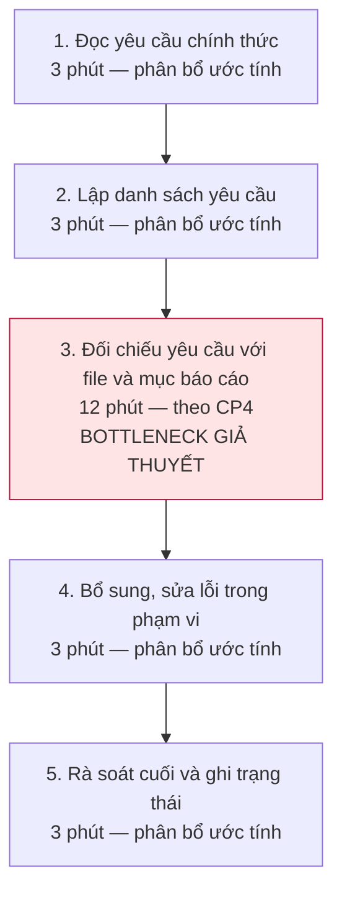
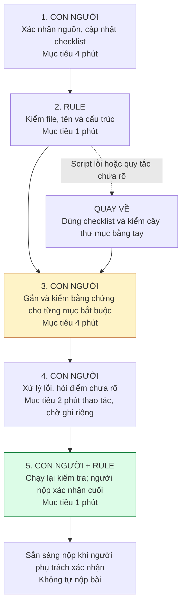

# Báo cáo nhóm — Day 02 Discovery & Problem Framing

> Bản chung của nhóm, viết trên repo do nhóm trưởng fork. Không copy file này sang repo cá nhân.
> Template chi tiết và prompt mẫu: [docs/01-worksheet.md](../../docs/01-worksheet.md). Bài mẫu: [docs/02-deliverable-example.md](../../docs/02-deliverable-example.md).

## 1. Thông tin nhóm

- Tên nhóm:
- Thành viên: xem `TEAM.md`
- Candidate problem được chọn (1 câu): Khi chuẩn bị nộp bài lab môn học, tôi muốn đối chiếu nhanh bài làm và cấu trúc thư mục của mình với toàn bộ rubric/checklist yêu cầu, để đảm bảo không bị trừ điểm oan do thiếu mục hoặc sai quy cách nộp bài.
- Quyết định cuối: Go / Not Yet / No-Go

---

## 2. Hội tụ nhóm (CP3)

### 2.1. Pitch

| # | Người đưa ra | Candidate (Job Story ngắn) | Actor | Bottleneck | Câu hỏi phản biện nhận được (ai hỏi) |
|---:|---|---|---|---|---|
| 1 | Nguyễn Nam Khánh | Khi làm bài lab và gặp thuật ngữ mới, tôi muốn xác định kiến thức nền cần hiểu trước, để tránh tìm hiểu lan man và tiếp tục làm bài. | Sinh viên AI thực chiến chưa có nhiều kiến thức chuyên môn | Bước 4: xác định kiến thức liên quan cần hiểu trước ước lượng 5 phút, chưa bấm giờ. | |
| 2 | Nguyễn Nam Khánh | Khi chuẩn bị nộp bài lab/minilab, tôi muốn đổi tên file, điền và kiểm tra thông tin đúng quy định, để tránh mất điểm do sai quy cách. | Sinh viên AI thực chiến | Bước 2–4: đổi tên file, điền và kiểm tra thông tin; khoảng 5 phút theo card | |
| 3 | Nguyễn Nam Khánh | Khi tìm kiếm và phác thảo ý tưởng dự án, tôi muốn tham khảo, đánh giá và tổng hợp các hướng đi, để chọn được một ý tưởng khả thi và phù hợp. | PM | Bước 3: tìm nguồn tham khảo, đánh giá, tổng hợp và phát triển các hướng (ước lượng 20 phút, chưa bấm giờ). | |
| 4 | Hồ Anh Tú | Khi bước vào đầu mỗi tuần với lịch học đan xen dày đặc giữa UET và VinUni, tôi muốn có danh sách tổng hợp mọi deadline bài tập, lịch thi và phòng học trong 7 ngày tới tập trung tại một nơi, để không bị nộp muộn hoặc chạy nhầm lịch giữa hai cơ sở. | Sinh viên năm cuối đang học song song 2 chương trình (ĐH chính quy & Chương trình đào tạo nhân tài). | Bước 3 & 4: Tìm và lọc thông báo deadline trôi dạt trong các kênh chat Discord/Sheet, mất khoảng 12–15 phút vì tin nhắn thảo luận làm loãng thông tin. | |
| 5 | Hồ Anh Tú | Khi chuẩn bị nộp bài lab môn học, tôi muốn đối chiếu nhanh bài làm và cấu trúc thư mục của mình với toàn bộ rubric/checklist yêu cầu, để đảm bảo không bị trừ điểm oan do thiếu mục hoặc sai quy cách nộp bài. | Học viên làm bài lab kỹ thuật/AI có nhiều quy định chặt chẽ về cấu trúc nộp bài. | Bước 3 & 5: Đọc đối chiếu từng tiêu chí trong file rubric dài với bài làm thực tế, mất khoảng 12–15 phút và rất dễ bỏ sót. | |
| 6 | Hồ Anh Tú | Khi bắt đầu một buổi tự học vào buổi tối trong trạng thái quá tải trước hàng đống task dồn dập, tôi muốn xác định ngay 1–2 việc cụ thể cần hoàn thành trong 90 phút đầu, để vượt qua cảm giác hoang mang và sức ỳ trì hoãn. | Sinh viên năm cuối chịu áp lực kép từ 2 trường, bị phân tâm tâm lý. | Bước 2 & 3: Trì hoãn và lúng túng trong việc ra quyết định chọn task để bắt đầu, mất từ 30–45 phút. | |
| 7 | Lê Thanh Tùng | Khi có tài liệu nghiệp vụ hoặc bài giảng mới, tôi muốn soạn được 50 câu hỏi có đáp án và độ khó phù hợp, để đánh giá đúng nội dung cần học và phát hành kịp thời. | Giảng viên hoặc chuyên viên đào tạo phụ trách soạn đề; người có chuyên môn duyệt nội dung. | Dự kiến ở bước viết câu hỏi: phải chuyển ý chính thành câu hỏi có phương án nhiễu hợp lý.  | |
| 8 | Lê Thanh Tùng | Khi giao task và cập nhật tiến độ qua chat, tôi muốn biết rõ ai phụ trách, hạn nào và trạng thái đã được xác nhận, để tránh bỏ sót, làm trùng và báo cáo sai tiến độ. | Trưởng nhóm tổng hợp; thành viên xác nhận công việc của mình. | Dự kiến ở bước hỏi lại để xác nhận người phụ trách, deadline và trạng thái. | |
| 9 | Lê Thanh Tùng | Khi quản lý một cộng đồng có bảng xếp hạng giờ học và nhận report về việc treo máy, tôi muốn xác minh phiên bị phản ánh theo nội quy, để giữ công bằng cho người học thật và tránh xử lý nhầm. | Quản trị viên trực tiếp kiểm tra report; người học và thành viên bị báo cáo là các bên liên quan. | Bước xác minh: quản trị viên phải đối chiếu report, thông tin phiên và giải thích của thành viên. Không thể theo dõi liên tục mọi màn hình; một ảnh chụp hoặc việc ít chuyển động cũng chưa đủ để kết luận. | |
| 10 | Vũ Văn Bình | Khi yêu cầu bài tập được cập nhật qua nhiều kênh, tôi muốn xác định yêu cầu cuối cùng áp dụng cho bài của mình, để không bỏ sót tiêu chí hoặc làm theo bản cũ. | Sinh viên chịu trách nhiệm kiểm tra yêu cầu cho một bài tập cụ thể. | Bước 4 — đối chiếu phiên bản: ước tính 7 phút/bài, trong tổng 22 phút thao tác; không tính chờ trả lời. | |
| 11 | Vũ Văn Bình | Khi nhận đủ các phần bài nhóm, tôi muốn phát hiện và xử lý nội dung trùng, thiếu hoặc mâu thuẫn, để tạo một bài thống nhất trước hạn nộp. | Thành viên được giao tổng hợp một báo cáo nhóm. | Ước tính 25 phút/bài, với báo cáo 12–15 trang của nhóm 4 người. | |
| 12 | Vũ Văn Bình | Khi một quầy thuốc đăng ký tham gia mạng lưới tiếp thị, tôi muốn kiểm tra khoảng cách đường chim bay từ quầy đó đến các quầy đã được nhận, để chỉ tiếp nhận quầy mới khi không có quầy đã tham gia nằm cách dưới 3 km. | Dược sĩ phụ trách tiếp thị và xét duyệt quầy thuốc tham gia mạng lưới. | Bước 4 — đối chiếu khoảng cách: ước tính 5 phút/hồ sơ, theo kịch bản 10 quầy đã nhận × 0,5 phút/lần đo; tổng xử lý 12 phút/hồ sơ. | |

### 2.2. Cluster

| Cluster | Các candidate | Pattern chung |
|---|---|---|
| A | | |
| B | | |
| C | | |

### 2.3. Opportunity Solution Tree rút gọn

Gốc là **1 outcome**. Nhánh là **opportunity** (nhu cầu, pain), không phải tính năng hay công cụ.

```text
OUTCOME: 
├── Opportunity A: 
├── Opportunity B: 
└── Opportunity C: 
```

Những ý đã gạch bỏ vì là solution đội lốt opportunity:

-

### 2.4. Chấm điểm shortlist (1–5)

| Candidate | Actor rõ | Quy trình rõ | Pain có bằng chứng | Impact đo được | Vừa sức lab | So sánh được No AI/Rule/Workflow/Agent | Nhóm hiểu domain | Tổng |
|---|---:|---:|---:|---:|---:|---:|---:|---:|
| | | | | | | | | |
| | | | | | | | | |
| | | | | | | | | |

**Candidate được chọn:** Candidate #5 — Khi chuẩn bị nộp bài lab môn học, tôi muốn đối chiếu nhanh bài làm và cấu trúc thư mục của mình với toàn bộ rubric/checklist yêu cầu, để đảm bảo không bị trừ điểm oan do thiếu mục hoặc sai quy cách nộp bài.

**Vì sao chọn:**

**Vì sao loại các candidate còn lại:**

**Xử lý bất đồng (nếu có):**

---

## 3. Kiểm chứng + research giải pháp đã có (CP4)

### 3.1. Assumption Map

Phạm vi kiểm chứng ban đầu: học viên nộp bài lab kỹ thuật/AI có rubric, checklist và quy định cấu trúc thư mục. Chưa chốt giải pháp hoặc mức can thiệp AI.

| # | Giả định | Loại (Value / Usability / Feasibility / Viability) | Quan trọng (1–5) | Đã có bằng chứng (1–5) | Kiểm chứng trước? |
|---:|---|---|---:|---:|---|
| 1 | Đối chiếu rubric/checklist với bài làm thực tế là bước nghẽn chính trước khi nộp, thay vì chưa hoàn thành nội dung chuyên môn hoặc gặp lỗi Git/nền tảng nộp bài. | Value | 5 | 2 | ✅ |
| 2 | Có thể xác định bộ yêu cầu chính thức đang áp dụng và chuyển các yêu cầu về mục bắt buộc, tên file, cấu trúc thư mục thành tiêu chí đối chiếu rõ ràng. | Feasibility | 5 | 1 | ✅ |
| 3 | Phần lớn lỗi thiếu mục/sai quy cách trong phạm vi đã chọn có thể phát hiện từ bộ yêu cầu và các file nộp, không cần hệ thống chấm điểm hoặc suy đoán tiêu chí của giảng viên. | Feasibility | 5 | 1 | Kiểm chứng sau |
| 4 | Quy định môn học cho phép hình thức hỗ trợ kiểm tra dự kiến và việc sử dụng tài liệu/bài làm tuân thủ yêu cầu bảo mật, liêm chính học thuật. | Viability | 5 | 1 | ✅  |

Giả định nhóm dự kiến kiểm chứng trong buổi này: Đối chiếu rubric/checklist với bài làm thực tế là bước nghẽn chính trước khi nộp, thay vì chưa hoàn thành nội dung chuyên môn hoặc gặp lỗi Git/nền tảng nộp bài.

### 3.2. Kiểm chứng

Cách đã dùng: Phỏng vấn

Interview snapshot (mỗi buổi phỏng vấn một bảng, hoặc đặt file trong `report/assets/cp4-interview-snapshot-N.md`):

| Trường | Nội dung |
|---|---|
| Người được hỏi (vai trò, không ghi tên thật) | Sinh viên làm lab kỹ thuật |
| Câu nói đáng nhớ nhất (nguyên văn) | Tôi đã đọc hết hướng dẫn, nhưng lúc kiểm tra vẫn không chắc mỗi yêu cầu đang nằm ở file nào. |
| Lần gần nhất gặp vấn đề này: chuyện gì đã xảy ra? | Khi kiểm tra bài trước hạn nộp, phát hiện thiếu báo cáo PDF và phải bổ sung. |
| Hiện đang xử lý bằng cách nào (workaround)? | Tự lập checklist Markdown, ghi đường dẫn file cạnh từng yêu cầu. |
| Mất bao lâu, bao lần? | 24 phút cho một lần nộp: gom yêu cầu 6 phút, đối chiếu 12 phút, bổ sung và kiểm tra cuối 6 phút. |
| Insight / opportunity rút ra | Khó nối từng yêu cầu với file tương ứng. Với bài quen thuộc và checklist tập trung, việc kiểm tra có thể chỉ mất 5 phút. |

| Trường | Nội dung |
|---|---|
| Người được hỏi (vai trò, không ghi tên thật) | Sinh viên quen làm lab Python, có checklist và script |
| Câu nói đáng nhớ nhất (nguyên văn) | “Kiểm tra tên file chỉ vài phút; cái làm mình trễ là notebook vẫn lỗi khi chạy lại từ đầu.” |
| Lần gần nhất gặp vấn đề này: chuyện gì đã xảy ra? | File nộp đúng quy cách nhưng notebook gặp lỗi xử lý dữ liệu khi chạy lại. |
| Hiện đang xử lý bằng cách nào (workaround)? | Dùng checklist từ lúc nhận đề, template thư mục và script kiểm tra file; chạy lại notebook trước khi nộp. |
| Mất bao lâu, bao lần? | Một lần nộp: kiểm tra file/checklist 4 phút, chạy notebook 8 phút, sửa lỗi kỹ thuật 25 phút. |
| Insight / opportunity rút ra | Checklist và script đã đủ cho phần hình thức; bottleneck nằm ở lỗi chuyên môn, không phải đối chiếu quy cách. |

| Trường | Nội dung |
|---|---|
| Người được hỏi (vai trò, không ghi tên thật) | Sinh viên tổng hợp và nộp báo cáo lab nhóm |
| Câu nói đáng nhớ nhất (nguyên văn) | “Tên file thì mình kiểm tra được, nhưng rubric yêu cầu ‘phân tích kết quả’ nên mình không chắc bảng số liệu và hai đoạn nhận xét đã đủ chưa.” |
| Lần gần nhất gặp vấn đề này: chuyện gì đã xảy ra? | Nhóm đủ file nhưng thiếu phần so sánh baseline được yêu cầu bổ sung qua tin nhắn. |
| Hiện đang xử lý bằng cách nào (workaround)? | Đối chiếu rubric và thông báo, liên kết checklist với đoạn báo cáo; hỏi trợ giảng khi tiêu chí chưa rõ. |
| Mất bao lâu, bao lần? | 31 phút thao tác cho một lần nộp; chờ trợ giảng trả lời thêm 20 phút, ghi riêng. |
| Insight / opportunity rút ra | Đủ file chưa có nghĩa nội dung đáp ứng rubric. Tiêu chí mơ hồ cần xác nhận với giảng viên; rubric thống nhất và ví dụ đạt có thể đã đủ. |

Tổng hợp:

| Nguồn | Số người / số mẫu | Tín hiệu xác nhận | Tín hiệu phản bác |
|---|---:|---|---|
| Phỏng vấn | 3 | Khó đối chiếu từng yêu cầu với đúng file hoặc đoạn nội dung, dễ bỏ sót báo cáo bắt buộc; yêu cầu phân tán giữa rubric và tin nhắn khiến phải rà nhiều nguồn; đủ file và đúng tên chưa bảo đảm đủ mục nội dung. | Checklist và script có thể đã đủ với bài quen thuộc.|

**Nhóm đã sửa problem thế nào sau kiểm chứng:**  Thu hẹp phạm vi vào việc phát hiện thiếu mục bắt buộc và sai quy cách nộp bài, thay vì đánh giá toàn bộ chất lượng bài làm. Ưu tiên thử checklist và script đơn giản trước khi cân nhắc AI để giảm chi phí và dễ áp dụng.


### 3.3. Research giải pháp đã có

| Công cụ / case / pattern | Link | Giải bước nào trong quy trình? | Điểm mạnh | Khoảng trống / rủi ro | Bài học cho nhóm |
|---|---|---|---|---|---|
| Notion/Giấy — checklist đối chiếu thủ công (No AI) | [Notion: Writing & editing basics](https://www.notion.com/help/writing-and-editing-basics) | Gom yêu cầu từ README/rubric thành checklist; người nộp tự đối chiếu file và mục báo cáo trước khi nộp. | Notion có checkbox, bảng và liên kết. Đề xuất áp dụng: mỗi yêu cầu gắn với đường dẫn file/đoạn báo cáo; bản giấy cũng dùng được cho checklist thủ công. | Người dùng vẫn phải cập nhật yêu cầu và tự kiểm tra; tick đủ không chứng minh nội dung đạt rubric. Đây là giới hạn của cách áp dụng đề xuất, chưa đo trên bài thật. | Thử checklist tập trung trước; đo thời gian và lỗi bỏ sót để biết có cần tự động hóa hay không. |
| Linter Script — script kiểm tra quy cách qua pre-commit (Rule) | [pre-commit: tài liệu chính thức](https://pre-commit.com/#repository-local-hooks) | Đề xuất viết script kiểm tra file bắt buộc, tên MSSV_HoTen và cấu trúc thư mục; chạy trước commit hoặc chạy thủ công trên toàn bộ file. | pre-commit hỗ trợ hook cục bộ và chạy kiểm tra tự động khi commit; quy tắc cố định có thể tái sử dụng. | Không có sẵn bộ kiểm tra rubric của lớp: nhóm phải viết và cập nhật script. Linter định dạng không tự xác nhận file bắt buộc hoặc chất lượng nội dung; kiểm tra thiếu file cần xét toàn bộ cây thư mục. | Tách điều kiện đúng/sai rõ sang Rule; chỉ báo lỗi theo quy định đã xác nhận, không coi script chạy đạt là bài chắc chắn đủ điểm. |

---

## 4. Quy trình trước/sau (CP5)

> Người tổng hợp: Vũ Văn Bình. Dựa trên candidate và phạm vi CP4 tại [nhánh nguyennamkhanh, commit bd8c710](https://github.com/TuHoAnh/K5-L3B-DAY02-VanMinh-DiscoveryProblemFraming/blob/bd8c710e3eb5456b69e37236a2cebffdf55e39c2/report/team/group_report.md). Chỉ xét thiếu file, sai tên/cấu trúc và thiếu mục nội dung bắt buộc; không chấm chất lượng chuyên môn. Các mốc 24, 4 và 31 phút được trích theo nội dung CP4, chưa được xác minh độc lập trong CP5. Phân bổ chi tiết các bước chưa có trong CP4 được ghi là ước tính; thời gian tương lai là mục tiêu đề xuất, chưa phải kết quả đạt được.

### 4.1. Quy trình hiện tại

Phạm vi đo: bắt đầu khi đã có bản bài làm cần kiểm tra và bộ yêu cầu; kết thúc khi có bản kiểm tra cuối sẵn sàng nộp. Ghi riêng thời gian chờ trợ giảng và thao tác upload/push/LMS; không tính thời gian viết toàn bộ bài hoặc sửa lỗi chuyên môn ngoài phạm vi.

Sơ đồ quy trình hiện tại — **24 phút theo snapshot thứ nhất ở CP4**; mốc tham chiếu của một trường hợp, không phải trung bình của cả nhóm:



| Bước | Actor | Input | Output | Thời gian / tần suất | Ghi chú |
|---:|---|---|---|---|---|
| 1 | Học viên phụ trách nộp bài | README, SUBMISSION, rubric và cập nhật chính thức | Danh sách nguồn đang áp dụng; điểm mâu thuẫn cần hỏi | Ước tính phân bổ 3 phút/lần nộp | Cùng bước 2 tạo nhóm “gom yêu cầu” 6 phút theo snapshot thứ nhất ở CP4. Không tự chọn giữa hai hướng dẫn mâu thuẫn. |
| 2 | Học viên phụ trách nộp bài | Bộ yêu cầu ở bước 1 | Checklist gồm yêu cầu, nguồn, vị trí bằng chứng dự kiến | Ước tính phân bổ 3 phút/lần nộp | Chưa có đo riêng bước 1 và 2; cách chia 3 + 3 chỉ dùng để mô tả quy trình. |
| 3 | Học viên phụ trách nộp bài | Checklist và bản bài làm | Trạng thái từng yêu cầu: có, thiếu, chưa rõ; đường dẫn file/tiêu đề | Theo CP4: 12 phút/lần nộp | Bottleneck giả thuyết: tìm đúng bằng chứng cho từng yêu cầu, không chỉ kiểm file tồn tại. |
| 4 | Người viết phần liên quan; học viên tổng hợp | Danh sách lỗi/thiếu đã xác nhận | File, tên, cấu trúc hoặc mục nội dung đã bổ sung | Ước tính phân bổ 3 phút/lần nộp | Chỉ sửa lỗi trong phạm vi. Nếu phải viết lại nội dung chuyên môn thì ghi riêng công việc đó. |
| 5 | Học viên chịu trách nhiệm nộp | Bản đã sửa và checklist | Checklist kiểm tra cuối, bản bài làm được người nộp xác nhận | Ước tính phân bổ 3 phút/lần nộp | Cùng bước 4 tạo nhóm “bổ sung và kiểm tra cuối” 6 phút theo snapshot thứ nhất ở CP4. |

**Bottleneck chính:** bước 3 — đối chiếu từng yêu cầu với đúng file hoặc mục nội dung, chiếm 12/24 phút theo snapshot thứ nhất ở CP4. CP5 chưa có phép đo độc lập cho bước này. Cần phân biệt “đã có mục phân tích” với “phân tích đủ tốt”: CP5 chỉ xử lý sự hiện diện của mục bắt buộc và quy cách đã xác định.

CP4 còn ghi trường hợp kiểm checklist chỉ 4 phút và trường hợp 31 phút thao tác + 20 phút chờ trợ giảng. Không lấy trung bình ba trường hợp do phạm vi công việc khác nhau; không áp mốc 24 phút cho mọi học viên. Lỗi notebook và thời gian chạy lại không thuộc bài toán đang chọn.

### 4.2. Quy trình tương lai

Phương án đề xuất để thử: checklist tập trung, gắn bằng chứng và Rule cho điều kiện đúng/sai rõ. **Chưa chốt mức can thiệp ở CP6**; chưa cần bước AI tạo hoặc đánh giá nội dung. Nhóm có thể thử checklist thủ công trước; chỉ thêm script khi lợi ích đo được đủ bù công thiết lập.



Các thời gian sau là **mục tiêu thiết kế**, chưa phải kết quả đạt được; tổng 12 phút không gồm công tạo script/checklist lần đầu, chờ phản hồi hoặc nộp bài. Các vòng kiểm lại phát sinh đều phải tính vào thời gian thao tác thực tế.

| Bước | Actor / mức xử lý | Input | Output | Thời gian / tần suất | Điểm kiểm soát |
|---:|---|---|---|---|---|
| 1 | Con người | Nguồn yêu cầu chính thức và checklist mẫu | Checklist phiên bản hiện tại: yêu cầu, nguồn, bằng chứng, trạng thái | Mục tiêu 4 phút/lần nộp | Người nộp kiểm tra thay đổi; yêu cầu chưa rõ được đánh dấu, không tự diễn giải thành quy tắc mới. |
| 2 | Rule/script | Checklist quy cách đã xác nhận và toàn bộ cây thư mục bài nộp | Báo cáo file thiếu, sai tên hoặc sai cấu trúc, kèm quy tắc áp dụng | Mục tiêu 1 phút/lượt | Script đọc toàn bộ cây thư mục, không chỉ file vừa sửa; không tự đổi tên/xóa/sửa nội dung. |
| 3 | Con người | Checklist, báo cáo Rule và bài làm | Liên kết mỗi mục bắt buộc tới file/tiêu đề/đoạn; đánh dấu có, thiếu hoặc chưa rõ | Mục tiêu 4 phút/lượt | Kiểm tra đoạn liên kết thực sự có nội dung; tiêu đề rỗng không đủ. Không suy ra đạt chất lượng từ việc mục đó tồn tại. |
| 4 | Người viết phần liên quan; người nộp điều phối | Danh sách thiếu/sai/chưa rõ | Bản sửa; câu hỏi gửi trợ giảng nếu cần | Mục tiêu 2 phút thao tác/lượt | Người viết tự bổ sung. Nếu cần sửa lớn thì vượt target và được ghi nhận, không bỏ qua để đạt thời gian. |
| 5 | Con người + Rule/script | Bản cuối, checklist và các thay đổi sau bước 4 | Báo cáo kiểm lại; người nộp xác nhận trạng thái cuối | Mục tiêu 1 phút/lượt | Kiểm lại trên bản cuối. Chỉ người chịu trách nhiệm mới quyết định nộp. |

**Boundary:**

- Chỉ sử dụng bộ yêu cầu chính thức đã được người nộp xác nhận; không tự đặt tiêu chí, bỏ tiêu chí hoặc suy đoán điểm số.
- Rule chỉ kiểm các điều kiện xác định được. Không biến “script chạy đạt” thành “bài đạt rubric” hay “được điểm cao”.
- Không có bước AI trong phương án hiện tại. Nếu CP6 bổ sung AI thì chỉ dùng trong phạm vi được môn học cho phép, kết quả phải có nguồn và được người nộp kiểm tra; không viết thay phần bắt buộc tự làm.
- Không tự sửa/xóa bài, không tự commit, push hoặc nộp LMS. Người viết sửa nội dung; người nộp xác nhận bản cuối.
- Yêu cầu mâu thuẫn hoặc mơ hồ phải chuyển cho giảng viên/trợ giảng xác nhận; phần đánh giá chất lượng chuyên môn nằm ngoài phạm vi kiểm tự động.

**Phương án quay về:** nếu script không chạy, báo sai hoặc chưa cập nhật đúng quy định, người nộp bỏ kết luận tự động và kiểm toàn bộ checklist cùng cây thư mục bằng tay. Nếu thiếu nguồn yêu cầu, quay lại bước 1; nếu tiêu chí chưa rõ, hỏi trợ giảng và ghi riêng thời gian chờ. Sau khi sửa vẫn phải rà bản cuối; không đánh dấu đạt để kịp target.

### 4.3. Before / after

| Chỉ số | Trước | Sau (kỳ vọng) | Ghi chú |
|---|---:|---:|---|
| Số bước xử lý chính | 5 | 5 | Giảm công đối chiếu, không đặt mục tiêu giảm số bước bằng cách bỏ kiểm tra. |
| Tổng thời gian thao tác | 24 phút theo CP4 | Mục tiêu ≤12 phút/lần nộp | Mức cải thiện dự kiến 50% so với mốc tham chiếu 24 phút; cần đo lại khi thử nghiệm. Trước: 3+3+12+3+3; sau: 4+1+4+2+1. Không gồm chờ và công thiết lập lần đầu. |
| Số bước thủ công | 5/5 | 4/5 có con người tham gia | Bước 2 chạy Rule; bước 5 kết hợp Rule và con người, vẫn tính là có thao tác thủ công. |
| Bottleneck chính | Đối chiếu yêu cầu với bằng chứng: 12 phút theo CP4 | Xác nhận yêu cầu và kiểm bằng chứng: mục tiêu 4 phút/bước | Chưa đo quy trình sau; vẫn giữ người kiểm ở các bước cần hiểu yêu cầu. |
| Rủi ro mới phát sinh | Chưa có kết luận tự động để dựa vào | Checklist/script cũ, báo đạt sai hoặc bỏ sót mục nội dung | Xác nhận phiên bản, dẫn nguồn yêu cầu, người kiểm bản cuối và quay về kiểm thủ công. |
| Chất lượng cần giữ | Chưa có tỷ lệ lỗi thực tế | Không tăng lỗi thiếu mục/sai quy cách; phát hiện đủ lỗi bắt buộc trên bộ thử đã xác nhận | Mục tiêu, chưa có kết quả. Không đo bằng điểm số do giảng viên chưa chấm. |

---

## 5. Problem Statement v0 (CP5)

> Bản nháp để nhóm tự rà soát và chốt; không phải kết luận đã kiểm chứng. Các số liệu giữ trạng thái tham chiếu CP4 hoặc mục tiêu đề xuất như mục 4; phần mô tả vấn đề không mặc định phải dùng một công cụ hoặc AI.

| Trường | Nội dung |
|---|---|
| **Actor** | Học viên hoặc thành viên chịu trách nhiệm tổng hợp và nộp một bài lab kỹ thuật/AI có rubric, quy định file và cấu trúc thư mục. Ưu tiên trường hợp phải đối chiếu nhiều mục; không mặc định mọi học viên đều gặp pain này. |
| **Quy trình** | Trước khi nộp: đọc bộ yêu cầu chính thức → lập checklist → đối chiếu từng yêu cầu với file/mục báo cáo → sửa thiếu/sai trong phạm vi → kiểm tra bản cuối. Không gồm hoàn thành chuyên môn, sửa lỗi chạy chương trình hoặc upload/push/LMS. |
| **Bottleneck** | Khó tìm và xác nhận bằng chứng tương ứng với từng yêu cầu bắt buộc khi hướng dẫn nằm ở nhiều tài liệu; có file hoặc tiêu đề chưa đủ để biết đã có nội dung cần nộp. Bước đối chiếu là bottleneck giả thuyết: 12 phút trong tổng 24 phút theo snapshot thứ nhất ở CP4; cần đo lại khi thử nghiệm. |
| **Impact** | Có nguy cơ thiếu file, sai tên/cấu trúc hoặc thiếu mục nội dung, dẫn đến sửa bổ sung sát hạn. CP4 ghi 24 phút thao tác cho một lần kiểm ở snapshot thứ nhất; chưa có thống kê tần suất, tỷ lệ lỗi hoặc bằng chứng điểm bị trừ, nên chưa quy đổi thiệt hại hay suy rộng cho mọi học viên. |
| **Success Metric** (baseline → target, cách đo) | Mốc tham chiếu theo CP4: 24 phút/lần → target thiết kế ≤12 phút/lần với bài có phạm vi tương đương. Trước pilot bấm giờ baseline trên bài thử rồi so sánh trên cùng bộ yêu cầu và các bản bài làm tương đương; nếu baseline khác 24 phút, tính lại mức cải thiện và xét có đáng can thiệp. Ghi từng bước, mọi vòng sửa/kiểm lại và công thiết lập lần đầu riêng. Đề xuất thử 3 cặp bản bài làm có lỗi quy cách/thiếu mục đã được người rà soát xác nhận, tránh kiểm lặp cùng một bản gây lợi thế ghi nhớ; mục tiêu không tăng lỗi còn sót và không bỏ qua lỗi bắt buộc trong bộ thử. Không coi kết quả bộ thử là bảo đảm điểm số hoặc độ chính xác tuyệt đối. |
| **Boundary** (AI không được làm gì; khi nào cần con người kiểm tra — HITL) | Chỉ kiểm quy cách và sự hiện diện của mục bắt buộc theo nguồn chính thức; không thay giảng viên chấm nội dung hoặc dự đoán điểm. Con người xác nhận bộ yêu cầu, kiểm bằng chứng, tự sửa phần của mình và duyệt bản cuối trước nộp. Phương án hiện tại chưa dùng AI; nếu thêm ở CP6, AI không được viết thay phần bắt buộc tự làm, tự quyết tiêu chí mơ hồ, sửa/xóa bài hoặc tự nộp. Script lỗi hoặc kết quả không rõ thì quay về checklist thủ công và hỏi giảng viên/trợ giảng khi cần. |

Phản biện nhận được (từ AI hoặc nhóm khác) và nhóm có đồng ý không:

- **AI:** Ba snapshot CP4 có thời gian và phạm vi khác nhau; không lấy mốc 24 phút làm thời gian trung bình hoặc áp dụng cho mọi học viên. CP5 đã chọn một trường hợp tham chiếu và yêu cầu đo lại trước pilot. **Ý kiến nhóm: chưa ghi nhận.**
- **AI:** Một trường hợp chỉ mất 4 phút kiểm quy cách, nên không thể mặc định giải pháp mới luôn có lợi. Cần giữ phương án checklist đơn giản, đo riêng nhóm người có pain và tính công thiết lập. **Ý kiến nhóm: chưa ghi nhận.**
- **AI:** Có đủ file/tiêu đề không chứng minh nội dung đạt chất lượng. Boundary đã tách kiểm mục bắt buộc khỏi chấm chuyên môn; tiêu chí chưa rõ phải hỏi người có thẩm quyền. **Ý kiến nhóm: chưa ghi nhận.**
- **AI:** Mục tiêu nhanh hơn có thể che giấu lỗi bị bỏ sót. Kế hoạch đo đã thêm kiểm lỗi còn lại, không chỉ đo thời gian. Quy trình tương lai và target cần nhóm tự rà từng bước trước khi chốt. **Ý kiến nhóm: chưa ghi nhận.**

---

## 6. Mức can thiệp AI (CP6)

> Phần CP6 do Lê Thanh Tùng chuẩn bị, có AI hỗ trợ soạn và phản biện. Đây là đề xuất để nhóm chốt sau CP4–CP5, chưa phải biên bản quyết định chung. Chưa có baseline quan sát hoặc kết quả benchmark; mọi ngưỡng bên dưới là mục tiêu đề xuất.

### 6.1. Ma trận độ mơ hồ × độ phức tạp

Bài toán được giới hạn trong **một bài lab, một phiên bản yêu cầu, một snapshot bài làm**. Phần kiểm cấu trúc có độ mơ hồ thấp và độ phức tạp thấp đến trung bình; phần đánh giá chất lượng nội dung có độ mơ hồ cao hơn.

Tên tệp, vị trí thư mục và số mục bắt buộc có thể biểu diễn thành điều kiện rõ ràng. Ngược lại, “bottleneck đủ cụ thể” hoặc “bằng chứng đủ sức thuyết phục” cần đọc ngữ cảnh và có thể cần coach xác nhận. Vì vậy, tách hai loại kiểm tra; không coi việc đủ heading là đáp ứng toàn bộ rubric.

### 6.2. So sánh 4 mức

| Mức | Phương án cho bài của nhóm | Đủ khi nào | Rủi ro | Chọn? |
|---|---|---|---|---|
| **No AI** (sửa quy trình) | Một checklist thống nhất, dẫn về đúng README/rubric/hướng dẫn nộp. | Người học rà nhanh và ít bỏ sót trên một bài cụ thể. | Checklist lỗi thời hoặc vẫn phải tìm từng mục bằng tay. | Giữ làm baseline và phương án quay về. |
| **Rule** | Người duyệt yêu cầu cấu hình các điều kiện rõ; script kiểm đường dẫn, tên tệp và cấu trúc; người học kiểm nội dung. | Lỗi thuộc các quy tắc đã định nghĩa, đầu vào đọc được và đúng phiên bản. | Có cấu trúc nhưng nội dung chưa đạt; rule cũng cần bảo trì. | **Đề xuất chọn cho phạm vi thử đầu tiên.** |
| **Workflow** | Rule trước; AI gợi ý thiếu nội dung kèm nguồn; người học xác nhận và sửa. | Có bằng chứng phần đọc hiểu vẫn nghẽn, và thử nghiệm chứng minh lợi ích tăng thêm so với Rule. | Bịa yêu cầu, dẫn nguồn sai, bỏ sót, tốn công sửa cảnh báo. | Chưa chọn ở giai đoạn hiện tại; là nhánh thử sau. |
| **Agent** | Công cụ tự chọn các bước, truy cập thêm tài liệu và thực hiện hành động. | Chỉ cân nhắc nếu có nhu cầu động mà các bước định sẵn không đáp ứng. | Quyền truy cập và hành động khó kiểm soát; có thể vượt phạm vi bài. | Không chọn: chưa có nhu cầu vượt quy trình cố định. |

**Mức đề xuất:** Rule cho kiểm cấu trúc, kết hợp người học tự rà nội dung. Demo HTML hiện thực hiện rule trong trình duyệt, chưa gọi AI và chưa chạy benchmark. Kiến trúc Rule + AI trong slide là phương án phát triển cần đánh giá riêng.

**Vì sao thử Rule bên cạnh No AI:** các phép kiểm xác định có thể lặp lại nhiều lần mà người học không phải tìm lại từng đường dẫn và đếm từng mục. Đây mới là giả thuyết lợi ích. Nếu checklist cho thời gian và lỗi còn sót tương đương hoặc tốt hơn sau khi tính cả công cấu hình/bảo trì, giữ No AI. Chưa có căn cứ để khẳng định Rule tốt hơn trước khi đo.

### 6.3. AI Canvas rút gọn

Không áp dụng cho phương án Rule đang đề xuất, theo [RUBRIC — C10](../../RUBRIC.md). Đầu vào là bộ yêu cầu đã được người có trách nhiệm duyệt và snapshot bài được phép kiểm; đầu ra là danh sách kiểm tra có nguồn và phạm vi. Người học xem lại, sửa và tự nộp. Kết quả xử lý cảnh báo được dùng để sửa rule; không dùng bài riêng tư làm dữ liệu huấn luyện khi chưa có quyền.

### 6.4. Hai câu hỏi của Google PAIR

Không bắt buộc với mức Rule. Hai lưu ý thiết kế vẫn cần kiểm chứng:

- Hướng hỗ trợ là **augment**: người học giữ quyền sửa và nộp. Đây là lựa chọn thiết kế, chưa phải sở thích đã được phỏng vấn xác nhận.
- **Bỏ sót lỗi bắt buộc** rồi tạo cảm giác bài đã đủ có thể khiến người học mất cơ hội sửa; **báo nhầm** gây mất thời gian. Phải đo cả hai. Mục không thuộc khả năng kiểm hoặc thiếu dữ liệu cần chuyển người kiểm, không hiển thị đạt toàn bài.

---

## 7. Problem Statement v1 + tiêu chí đánh giá (CP6)

| Trường | Nội dung |
|---|---|
| **Actor** | Học viên chịu trách nhiệm rà và nộp một bài lab có yêu cầu về nội dung và quy cách tệp. |
| **Quy trình** | Xác nhận yêu cầu áp dụng → mở snapshot bài → đối chiếu yêu cầu → sửa và kiểm lại → tự nộp. Phạm vi đo kết thúc khi người học hoàn tất sửa/kiểm lại, trước bước nộp. |
| **Bottleneck** | Giả thuyết: bước tìm và đối chiếu từng yêu cầu với bài làm dễ tốn công và bỏ sót. Chưa có quan sát bấm giờ để xác nhận đây là bước nghẽn chính. |
| **Impact** | Có thể mất công rà lại hoặc bị trừ điểm vì thiếu mục/sai quy cách. Bài Tú tự báo cáo 25–30 phút rà bài; chưa coi đây là baseline chung hoặc lượng điểm LabCheck có thể cải thiện. |
| **Success Metric** (baseline → target, cách đo) | Baseline: chưa đo; cần đo checklist thủ công A trên cùng phạm vi. Mục tiêu đề xuất: trung vị tổng thời gian rà và sửa bằng Rule B ≤70% A, không tăng lỗi bắt buộc còn sót; recall lỗi cấu trúc ≥95%, precision cảnh báo cấu trúc ≥90%. Tính cả chờ công cụ, đọc cảnh báo và sửa báo nhầm; so bằng nhãn chuẩn và người chấm không biết điều kiện thử. |
| **Boundary** | Chỉ kiểm điều kiện đã cấu hình trên tệp được phép đọc; không suy ra chất lượng từ số heading; không chạy code/chỉ thị trong bài, tự sửa, tự nộp hoặc cấp điểm. Thiếu tệp, sai phiên bản hoặc yêu cầu mâu thuẫn phải báo chưa kiểm được/cần người kiểm. |
| **AI intervention point** | **Không có trong phương án Rule.** Phần đọc hiểu ngữ nghĩa vẫn do người học kiểm. Chỉ thử AI ở bước gợi ý đối chiếu nội dung nếu có nhu cầu đã kiểm chứng và benchmark so với Rule. |
| **Mức chọn** | Đề xuất Rule cho prototype; chưa xác nhận cho pilot hoặc triển khai rộng. |
| **Rủi ro & người kiểm tra** | Người học kiểm từng cảnh báo và các yêu cầu ngoài phạm vi rule; người duyệt bộ yêu cầu kiểm nguồn/phiên bản; người phụ trách đánh giá kiểm nhãn và lỗi còn sót. Danh sách người nhận vai cụ thể cần nhóm phân công trước pilot. |

**Điểm được làm rõ so với Job Story ban đầu:** CP5 chưa có v0 hoàn chỉnh để đối chiếu; bảng dưới ghi sự cụ thể hóa từ mô tả đầu vào, không giả định đã có một bản v0 được thông qua.

| Trường | Mô tả ban đầu | Đề xuất v1 | Vì sao làm rõ |
|---|---|---|---|
| Phạm vi | Xác định bài còn thiếu yêu cầu và sai quy cách nào. | Rule xử lý các điều kiện cấu trúc đã cấu hình của một bài; người học kiểm chất lượng nội dung. | Phân biệt việc có mục với việc đáp ứng rubric. |
| Metric | Sửa kịp deadline, tránh mất điểm do bỏ sót. | Đo tổng thời gian rà/sửa, recall, precision và lỗi còn sót; baseline chưa đo. | Kết quả mong muốn cần chuyển thành phép đo có mẫu số rõ. |
| Boundary | Người học sửa trước khi nộp. | Công cụ không tự sửa/nộp/chấm điểm; mục mơ hồ chuyển người kiểm. | Giảm nguy cơ tin nhầm rằng bài đã đạt toàn bộ. |

**Tiêu chí đánh giá phương án Rule (5 tiêu chí, theo quy định cho nhóm chọn Rule):** Các ngưỡng là đề xuất; không báo là kết quả đã đạt.

| # | Tiêu chí | Đạt khi | Không đạt khi |
|---:|---|---|---|
| 1 | Phát hiện lỗi cấu trúc bắt buộc trong phạm vi rule | Recall ≥95% trên lỗi cấu trúc trong nhãn chuẩn; báo tử số/mẫu số và từng loại lỗi. | Dưới ngưỡng; bỏ sót mà vẫn báo đã kiểm điều kiện đó. |
| 2 | Cảnh báo đúng | Precision ≥90% trên cảnh báo cấu trúc; chỉ rõ vị trí và cách tự kiểm. | Báo sai tệp/điều kiện; nhiều cảnh báo không có căn cứ. |
| 3 | Truy được về yêu cầu | Mỗi kết quả có mã yêu cầu, nguồn, phiên bản và đối tượng kiểm; nội dung khớp nguồn đã duyệt. | Dẫn nguồn không tồn tại, sai phiên bản hoặc tự thêm yêu cầu. |
| 4 | Giới hạn kết luận đúng phạm vi | Không có lần kết luận toàn bài đạt khi còn phần chưa kiểm hoặc dữ liệu mơ hồ; báo cả mức bao phủ và tỷ lệ chuyển người kiểm. | Đồng nhất đủ cấu trúc với đủ chất lượng, hoặc từ chối mọi trường hợp để né lỗi. |
| 5 | Có lợi ích sau khi tính công sửa | Trung vị tổng thời gian ≤70% A, lỗi bắt buộc còn sót không tăng; ghi riêng công cấu hình/bảo trì. | Không giảm đủ thời gian hoặc làm tăng lỗi còn sót, dù công cụ trả kết quả nhanh. |

**Thiết kế đo:** bộ 40 snapshot dự kiến gồm bốn loại: đủ cấu trúc, lỗi tệp, thiếu nội dung, mơ hồ/gây nhiễu; mỗi loại 10. Dành 8 mẫu phát triển và 32 mẫu giữ lại, tách theo bài gốc để tránh rò rỉ; hai người gán nhãn độc lập và xử lý bất đồng. Chấm recall/precision Rule trên lỗi thuộc phạm vi Rule; với lỗi nội dung, kiểm việc công cụ chuyển người kiểm đúng thay vì gán năng lực đọc hiểu chưa có. Pilot đề xuất 12 học viên với task tương đương và xoay thứ tự; giai đoạn đầu so A checklist với B Rule. Nếu thử thêm C Gemini và D Rule + AI, dùng thiết kế 12 × 4 = 48 phiên đã chuẩn bị trong [ghi chú benchmark](../assets/cp3-6-le-thanh-tung-labcheck.md). Chưa thu thập mẫu hoặc chạy các phép đo này.

---

## 8. Quyết định (CP6)

### 8.1. Bốn rủi ro

| Rủi ro | Câu hỏi | Mức độ rủi ro (Thấp = an toàn / TB / Cao = nguy hiểm) | Lý do / bằng chứng |
|---|---|---|---|
| **Value** | Người dùng có thật sự cần và sẽ dùng không? | Cao | Chưa có kiểm chứng ngoài nhóm hoặc đo so với checklist. Cần quan sát lần rà bài gần nhất và benchmark tổng công, không chỉ hỏi người dùng có thích ý tưởng không. |
| **Usability** | Người dùng có dùng được, có hiểu và sửa được đầu ra của AI không? | Cao | Chưa thử người dùng; có nguy cơ hiểu “đủ cấu trúc” thành “đạt toàn bài”. Dùng trạng thái có phạm vi, nguồn và phần phải tự kiểm; kiểm khả năng giải thích trạng thái trong pilot. |
| **Feasibility** | Có đủ dữ liệu, công cụ, kỹ năng để làm không? | TB | Có demo rule cục bộ nhưng chưa benchmark. Bộ yêu cầu phải được duyệt và cập nhật; phần nội dung tự do chưa giải quyết. Không chạy code trong bài; kiểm trên snapshot có nhãn trước khi dùng thật. |
| **Viability** | Có hợp chi phí, pháp lý, quy định tổ chức không? Ai vận hành? | Cao | Chưa xác nhận người bảo trì, quyền dùng dữ liệu và công vận hành. Ưu tiên tệp công khai hoặc mẫu được cho phép; không gửi bài riêng tư ra dịch vụ ngoài khi chưa có quyền. Cần người nhận vai và giới hạn chi phí trước pilot. |

### 8.2. Kết luận

**Đề xuất của Tùng: Not Yet** cho pilot dùng bài nộp thật và cho việc phát triển phần AI. Có thể tiếp tục chuẩn bị checklist, bộ yêu cầu và prototype Rule bằng dữ liệu mẫu được phép dùng. Đây chưa phải quyết định cuối đã được cả nhóm thông qua.

**Lý do:** rủi ro Value và Usability đang cao vì chưa có phỏng vấn và baseline. Demo thể hiện được cơ chế kiểm cấu trúc, chưa chứng minh người học tiết kiệm công hoặc ít bỏ sót hơn. Chưa có căn cứ chọn Workflow hay Agent.

**Điều kiện để chuyển sang Go thử nhỏ:** có kiểm chứng CP4 đúng yêu cầu; baseline cùng phạm vi; bộ yêu cầu và nhãn chuẩn được người có trách nhiệm duyệt; xác nhận quyền dữ liệu, người vận hành và ngưỡng dừng. Bắt đầu với một lab, so checklist với Rule, giữ người học kiểm và tự nộp; chỉ mở nhánh AI nếu phần Rule chưa đủ và có giả thuyết giá trị tăng thêm cụ thể.

**Việc tiếp theo:** kiểm chứng hai giả định “đối chiếu thật sự gây mất công” và “checklist chưa đủ”; hoàn thiện CP5; đo trên bộ phát triển, khóa cấu hình rồi đánh giá tập giữ lại. Lộ trình 14 ngày trong ghi chú là kế hoạch đề xuất, chưa phải lịch đã cam kết của các thành viên.

**Phương án đơn giản nếu không có lợi ích tăng thêm:** một checklist có nguồn và phiên bản, kèm script kiểm cấu trúc nếu script có lợi. Không cần thêm AI chỉ để có tính năng AI.

**Ngưỡng dừng đề xuất:** sau đợt đánh giá đã khóa cấu hình, nếu không đạt recall/precision hoặc không giảm ít nhất 30% tổng thời gian mà vẫn giữ lỗi còn sót không tăng, chưa mở rộng và quay về checklist/Rule phù hợp hơn. Nếu có một lần kết luận toàn bài đạt khi thiếu căn cứ, sai nguồn yêu cầu hoặc sử dụng dữ liệu vượt quyền, dừng phần liên quan ngay để sửa và kiểm lại trước khi tiếp tục.

---

## 9. Hạn chế và hướng tiếp theo

- Phần 6–8 là đề xuất CP6 của Tùng có AI hỗ trợ soạn, chờ nhóm tự chỉnh/chốt. CP3–CP5 cần các thành viên hoàn thành; chưa có đủ dữ liệu để xác nhận Problem Statement đã được kiểm chứng.
- Chưa có baseline quan sát trực tiếp, bộ nhãn chuẩn, kết quả benchmark hoặc pilot trong phần chuẩn bị CP6. Các ngưỡng là điều kiện đánh giá đề xuất, không phải hiệu quả đã đạt.
- Rule kiểm cấu trúc chưa đánh giá được chất lượng lập luận, độ thật của bằng chứng hay việc tuân thủ quy định tự viết reflection. Người học vẫn phải tự kiểm và chịu trách nhiệm về bài nộp.
- Sau kiểm chứng, nhóm cần chỉnh bottleneck, metric, v0/v1 và quyết định nếu dữ liệu phản bác giả thuyết hiện tại.

## 10. Tài liệu tham khảo

- [CHECKPOINTS](../../CHECKPOINTS.md), [RULES](../../RULES.md) và [RUBRIC](../../RUBRIC.md): yêu cầu và phạm vi sử dụng AI.
- [Ghi chú đóng góp và kế hoạch benchmark của Tùng](../assets/cp3-6-le-thanh-tung-labcheck.md), có liên kết về các báo cáo cá nhân làm nguồn bối cảnh.
- [GitHub Docs — Triggering a workflow](https://docs.github.com/en/actions/how-tos/write-workflows/choose-when-workflows-run/trigger-a-workflow): cơ chế chạy các kiểm tra theo sự kiện, không tự tạo rubric.
- [markdownlint](https://github.com/DavidAnson/markdownlint): công cụ kiểm định dạng Markdown, một phương án sẵn có để so sánh.
- [Gemini structured outputs](https://ai.google.dev/gemini-api/docs/structured-output): tài liệu tham khảo cho nhánh AI dự kiến; đúng schema không thay cho kiểm tra nội dung đầu ra.
